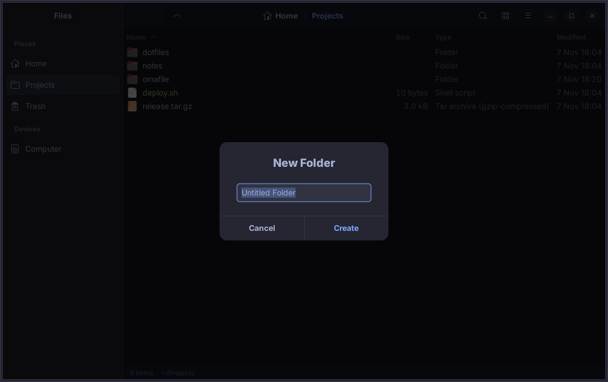

# omafile

A native GTK 4 / libadwaita file manager for [Omarchy](https://omarchy.org).
It looks like it shipped with the system: colours, accent and light/dark mode
come straight from the active Omarchy theme, and they follow along live when
you run `omarchy-theme-set`.


<details>
<summary>More screenshots</summary>

Grid view


Context menu


Same window, after switching to a light theme at runtime


New folder dialog



</details>

## Why

Omarchy ships Nautilus, a GNOME app that ignores the Omarchy theme and drags
along its own ideas about how a desktop works. omafile is a small, fast,
single-binary file manager built with the same toolkit as Walker and swayosd:

- **Theme-native.** Reads the 16-colour palette from
  `~/.config/omarchy/current/theme/alacritty.toml`, derives every libadwaita
  named colour from it (window, sidebar, headerbar, accent, selection, dialogs)
  and switches between light and dark from the theme's `light.mode` marker.
  Watches the theme link and re-skins itself the moment the theme changes.
- **Native widgets.** libadwaita header bar, overlay split view sidebar,
  `GtkColumnView` list and `GtkGridView` grid, toast notifications, adaptive
  dialogs. Icons come from the icon theme Omarchy sets (Yaru).
- **Keyboard-first.** Every action has a shortcut; `Ctrl+L` types a path,
  `Ctrl+F` filters, `F4` opens Alacritty in the current folder via `uwsm`.
- **Wayland-native** through GTK 4; opens files with the portal, copies paths
  to the clipboard, shares copied files with other GTK apps.
- **No config file.** Nothing to set up; it just follows the system.

## Install

```sh
git clone https://github.com/whogotpwned/omafile
cd omafile
./install.sh --all
```

That builds a release binary into `~/.local/bin`, installs the desktop entry
(so it appears in Walker and as an "Open With" target), makes omafile the
default application for folders, and replaces Nautilus on `SUPER+F` in
`~/.config/hypr/bindings.conf`. Pass `--default` or `--bind` for only one of
the last two, or nothing for just the binary.

Build dependencies on Omarchy: `sudo pacman -S --needed rust gtk4 libadwaita`.
Everything else (gvfs for trash and drives, the Hyprland portal for "Open
With") is already there.

Arch package:

```sh
makepkg -si
```

### Hyprland

`data/hyprland-bindings.conf` holds the `SUPER+F` binding plus optional window
rules for a centered floating window. The window class is
`io.github.whogotpwned.Omafile`.

## Keyboard shortcuts

| Keys | Action |
|---|---|
| `Alt+←` `Alt+→` | Back / forward |
| `Alt+↑` `Backspace` | Parent folder |
| `Alt+Home` | Home |
| `Ctrl+L` | Type a location (`~` works) |
| `Ctrl+F` | Filter the current folder |
| `F5` `Ctrl+R` | Reload |
| `Ctrl+1` `Ctrl+2` | List / grid view |
| `Ctrl+H` | Show hidden files |
| `F9` | Toggle sidebar |
| `Enter` | Open (folders navigate, files open with the default app) |
| `Ctrl+Shift+O` | Open with… |
| `F4` `Ctrl+Alt+T` | Open terminal here |
| `Ctrl+Shift+N` | New folder |
| `Ctrl+Alt+N` | New file |
| `F2` | Rename |
| `Ctrl+C` `Ctrl+X` `Ctrl+V` | Copy / cut / paste |
| `Ctrl+Shift+C` | Copy path |
| `Delete` | Move to trash |
| `Shift+Delete` | Delete permanently |
| `Ctrl+I` `Alt+Enter` | Properties |
| `Ctrl+?` | Shortcut overview |
| `Ctrl+W` `Ctrl+Q` | Close window / quit |

Right-click opens a context menu on items and on the background. Rubber-band
selection, `Shift`/`Ctrl` multi-select and sorting by column header work as
in any GTK list.

## Command line

```
omafile [DIRECTORY | FILE]...
```

A file argument opens its folder. Without an argument the current working
directory is shown.

| Variable | Meaning |
|---|---|
| `TERMINAL` | terminal for "Open Terminal Here", default `alacritty` |
| `OMAFILE_THEME_DIR` | override `~/.config/omarchy/current/theme` |

## How the theming works

omafile does not ship a stylesheet. At startup it parses
`<theme>/alacritty.toml`, maps the palette onto libadwaita's named colours
(`window_bg_color`, `accent_bg_color`, `sidebar_bg_color`, …) with a few
derived shades, installs that as a `GtkCssProvider`, and sets the
`AdwStyleManager` colour scheme from `light.mode`. A `GFileMonitor` on the
`current` directory catches the symlink swap that `omarchy-theme-set`
performs. Custom themes work as long as they contain an `alacritty.toml`,
which every Omarchy theme does.

## Development

```sh
cargo run -- ~/Projects
cargo test
cargo clippy
```

| Module | Role |
|---|---|
| `theme` | palette parsing, CSS generation, live reload |
| `item` | `FileItem` GObject (file + info) for the list models |
| `ops` | async GIO operations: list, copy, move, trash, delete, rename, create |
| `window` | sidebar, header, path bar, views, search, directory monitor |
| `actions` | window actions, clipboard, dialogs, properties, shortcuts |

## License

MIT
