`omarchy` `omarchy-plugin` `hyprland` `wayland` `linux` `file-manager` `gtk4` `libadwaita` `rust` `sftp` `scp` `quickshell` `tags` `thumbnails` `pdf-preview` `git` `gocryptfs` `encryption` `command-palette` `vte` `terminal` `python` `venv` `arch-linux`

<div align="center">

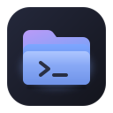

# omafile

**The file manager that feels like part of Omarchy.**

GTK 4 · libadwaita · Rust · theme-aware · Finder views · terminal inside · git inside · Python inside

[](CHANGELOG.md)
[](https://github.com/whogotpwned/omafile/actions/workflows/ci.yml)
[](#bar-button)
[](#how-it-follows-omarchy)
[](Cargo.toml)
[](PKGBUILD)
[](#development)
[](LICENSE)

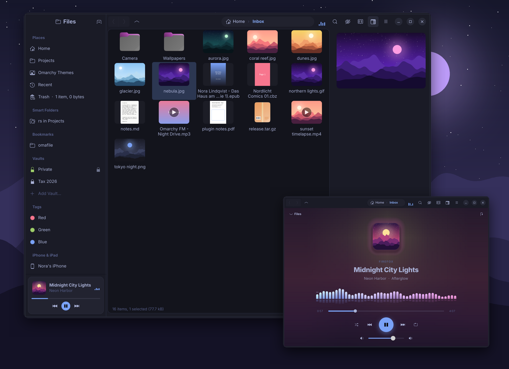

<sub>Two omafile windows, captured separately and arranged on a wallpaper. More in motion: <a href="docs/nowplaying.gif">Now Playing as a GIF</a>.</sub>

</div>

omafile is a native file manager for [Omarchy](https://omarchy.org) and an
Omarchy shell plugin that puts it on the bar. Colours, accent, light or dark
mode and the icon theme come from the active Omarchy theme and follow along
live when you switch. Below the files sits your shell, next to them your git
status, and every panel moves the way Hyprland moves.

```sh
git clone https://github.com/whogotpwned/omafile && cd omafile
sudo pacman -S --needed rust vte4            # the two things stock Omarchy lacks
./install.sh --all                           # binary, launcher, default app, Super+Shift+F
omarchy plugin add https://github.com/whogotpwned/omafile.git --enable   # bar button (optional)
```

<div align="center">

[Highlights](#highlights) · [Features](#features) · [Shortcuts](#keyboard-shortcuts) · [Command line](#command-line-and-launchers) · [Install](#install) · [Bar button](#bar-button) · [Omarchy](#how-it-follows-omarchy) · [Publishing](#publishing-as-an-omarchy-plugin) · [Development](#development) · [Changelog](CHANGELOG.md)

</div>

---

## Highlights

<table>
<tr>
<td width="33%">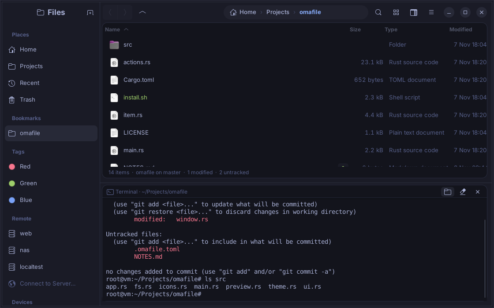<br><b>Terminal panel</b><br><sub>Your shell under the files, follows every folder, activates Python venvs. <code>Ctrl+`</code></sub></td>
<td width="33%">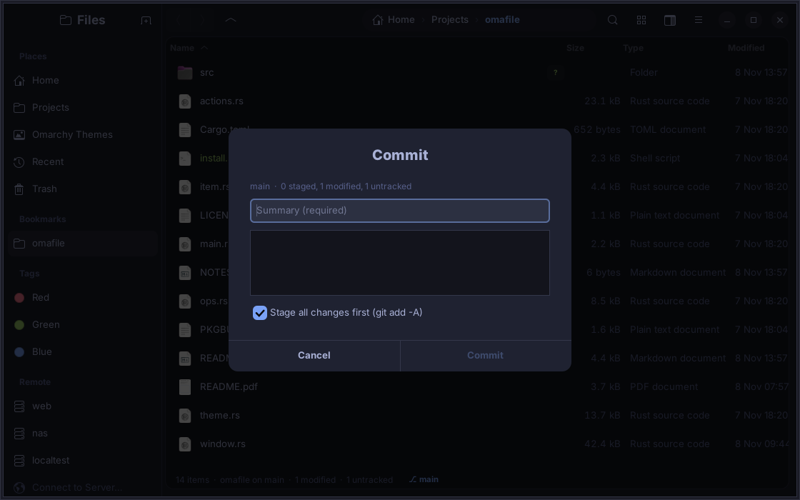<br><b>Git without a terminal</b><br><sub>Badges, click to stage, commit dialog, branch switcher, coloured diffs.</sub></td>
<td width="33%">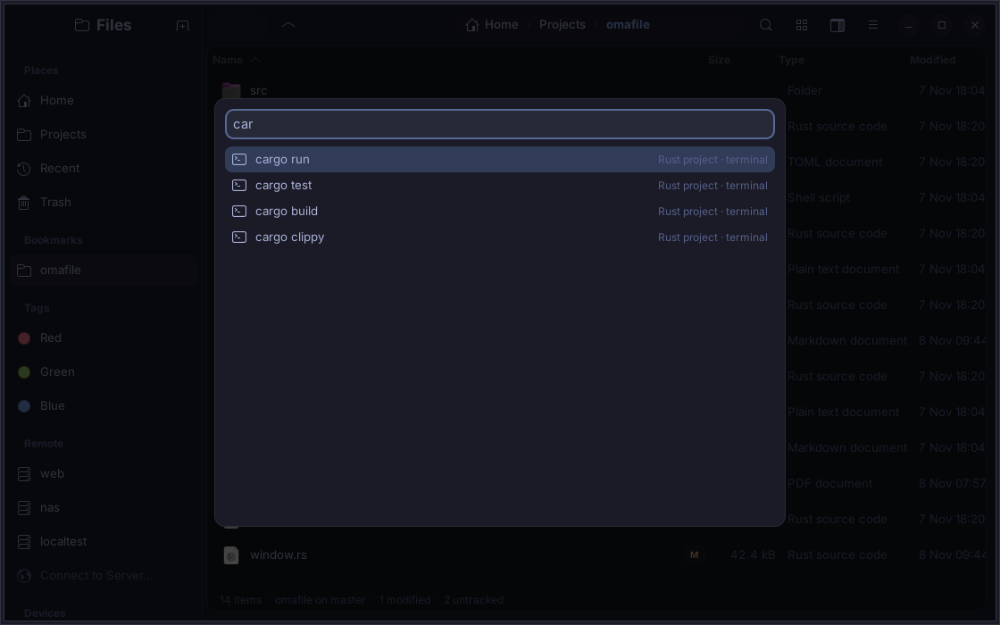<br><b>Command palette</b><br><sub>Every action, folder, project command and bulk rename behind <code>Ctrl+K</code>.</sub></td>
</tr>
<tr>
<td>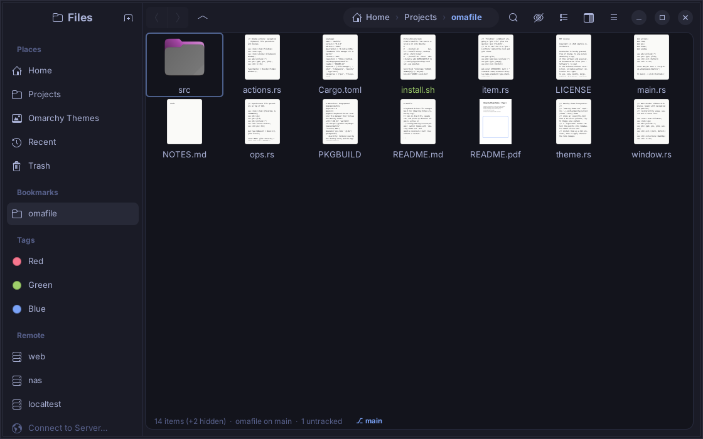<br><b>Previews in the icon</b><br><sub>Text pages, PDF pages, video frames, cover art. Space opens Quick Look and plays music.</sub></td>
<td>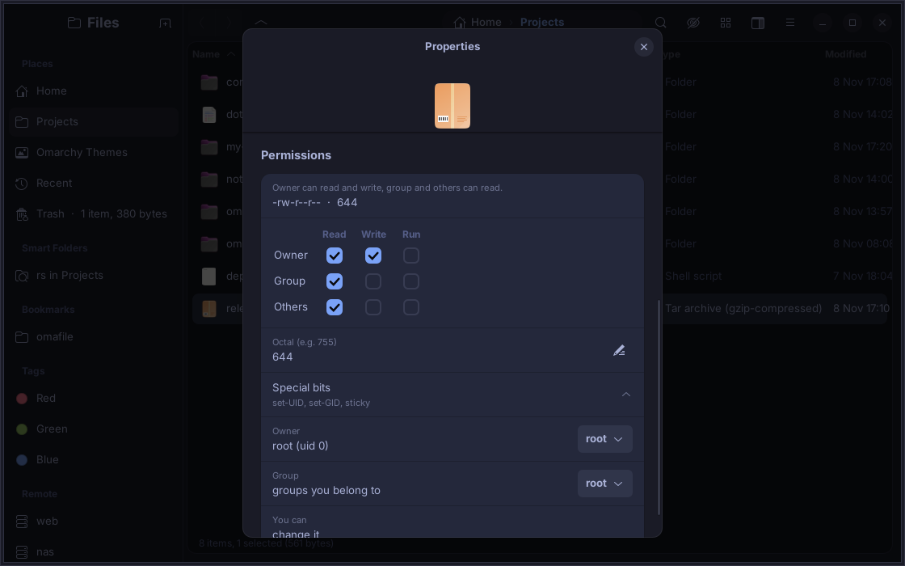<br><b>Permissions in plain words</b><br><sub>“Owner can read and write…”, check boxes, octal, owner and group. Undoable.</sub></td>
<td>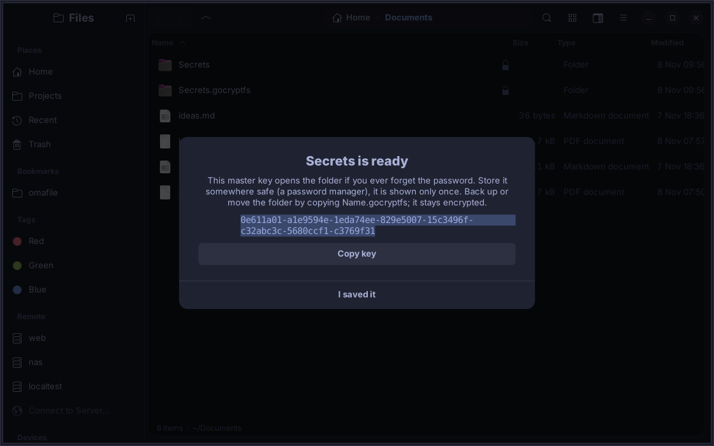<br><b>Encrypted folders</b><br><sub>gocryptfs vaults you can sync anywhere and unlock with a password.</sub></td>
</tr>
<tr>
<td>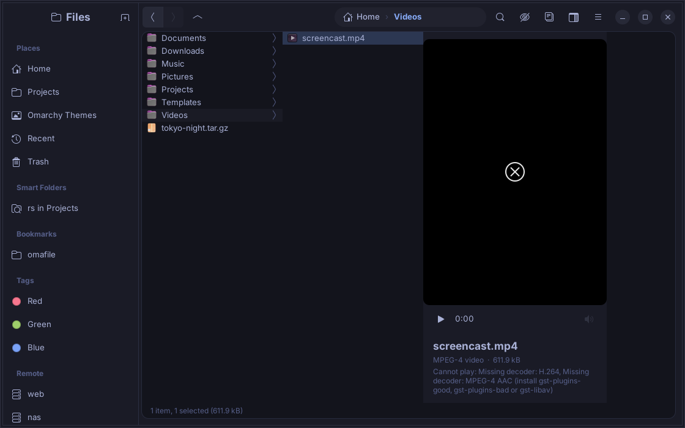<br><b>Finder views</b><br><sub>Miller columns, gallery with filmstrip, groups by kind / date / size / tag, <code>Ctrl+scroll</code> zoom.</sub></td>
<td>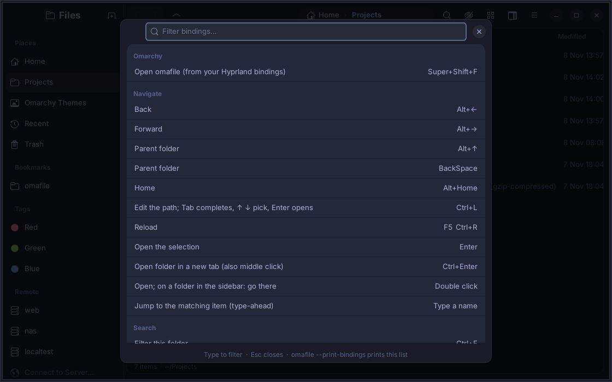<br><b>Every binding, searchable</b><br><sub><code>Ctrl+?</code> lists all shortcuts, gestures and menu entries, generated from the real table; <code>F1</code> is Help with all features and the version.</sub></td>
<td>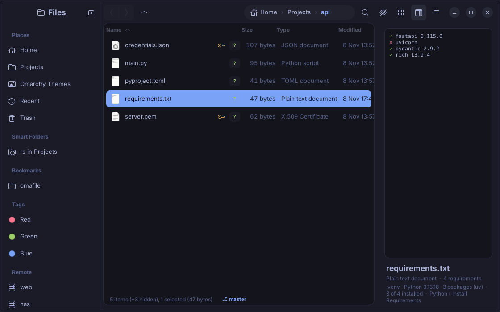<br><b>Python aware</b><br><sub>venv badge, requirements ✓/✗ against the venv, create / install / freeze from the menu.</sub></td>
</tr>
</table>

---

## Features

### Browse and preview

| | |
|---|---|
| 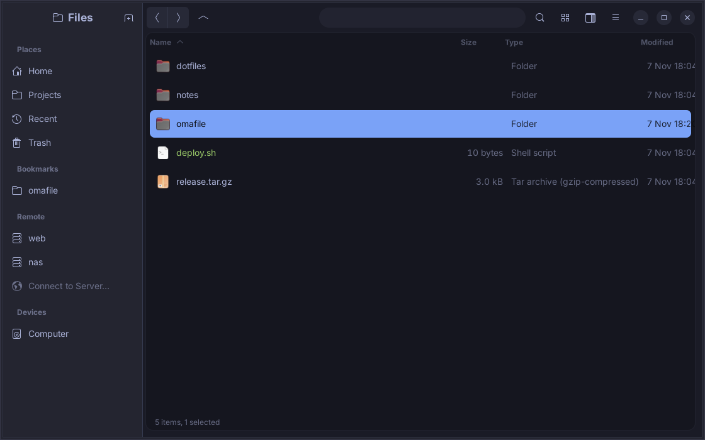 | **List and grid views** with sortable columns, rubber-band and multi-selection, live reload when a folder changes. **Hidden files** toggle with the eye button or `Ctrl+H`; hidden items are dimmed, italic and greyed, the status line counts them while hidden. **Zoom** the grid with `Ctrl+Plus` / `Ctrl+Minus` / `Ctrl+scroll`, `Ctrl+0` resets. Every icon and thumbnail sits in a tile of the same size: photos, videos and album art fill it, pages and book covers are shown whole on a faint card, so rows and columns line up whatever the folder holds. 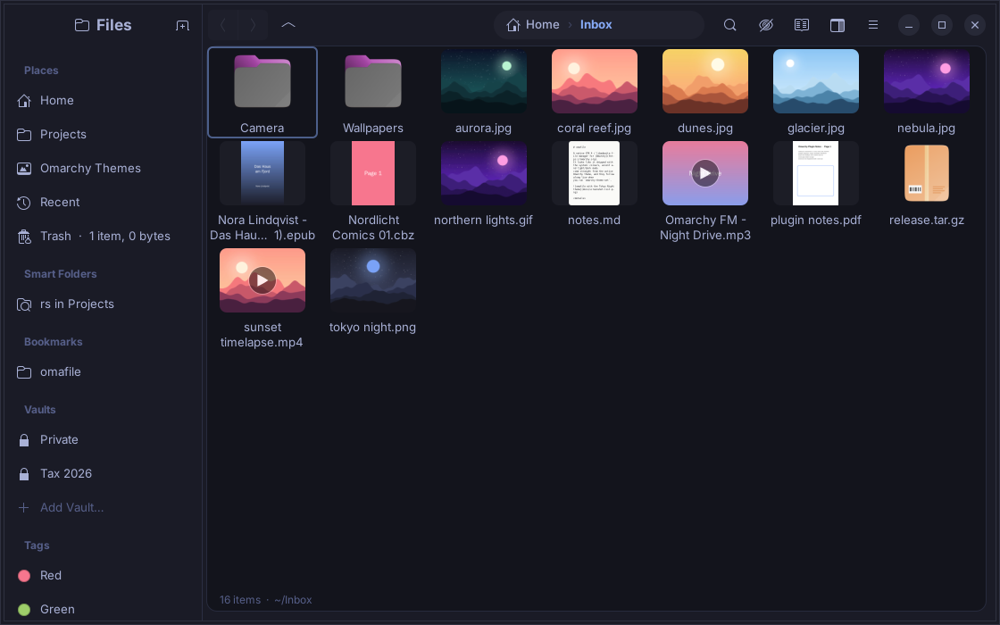 |
|  | **Column view** (`Ctrl+3`), Finder's Miller columns: every folder on the way from home is a column, the last one is the live folder, a selected file opens a preview column at the end. `←` and `→` move between columns, `Enter` opens. |
| 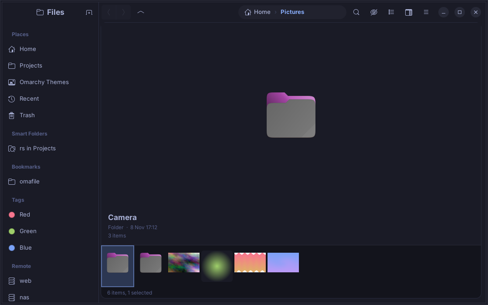 | **Gallery view** (`Ctrl+4`): a large preview with a filmstrip of thumbnails underneath, metadata beneath the picture. The header button cycles list → grid → columns → gallery. |
| 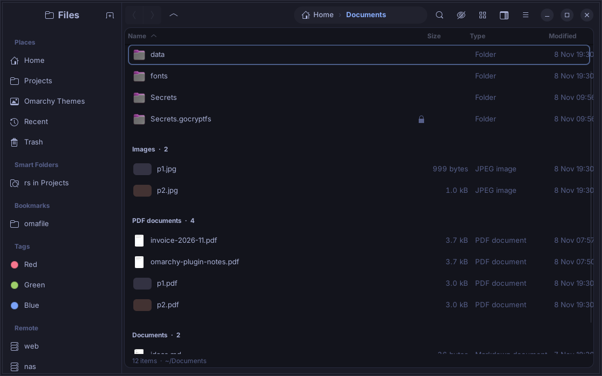 | **Groups** (menu › Group By): sections by kind (Folders, Images, PDF documents, eBooks, Documents, Code and config, Music, Videos, Archives), by date (Today, Yesterday, Previous 7 days…), by size or by tag, each with its count; the choice is remembered. |
|  | **Previews in the icon**, like Finder and Explorer: text and source files show a page with their first lines, images and SVGs their picture, PDFs their first page, videos a frame (`ffmpegthumbnailer`, else `ffmpeg`), music its cover art, theme folders their `preview.png`. Everything decodes off the main thread and is cached; credential files are never rendered. |
| 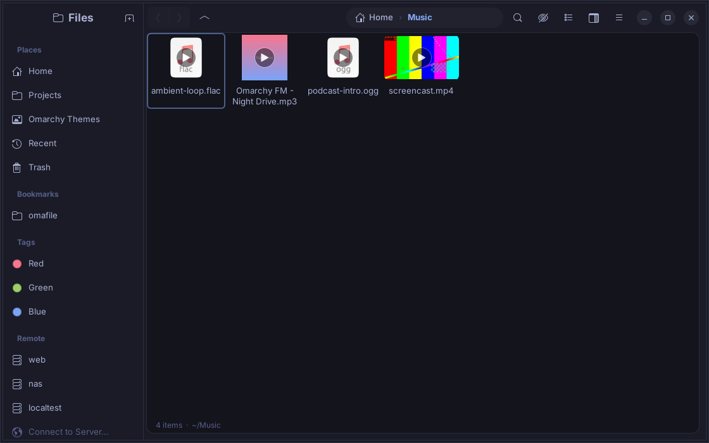 | **Play in place**: songs and videos carry a round play badge over their icon; one click starts them. Audio shows cover and transport controls in the preview pane, `Space` (Quick Look) plays right away, `←`/`→` walk the album. GStreamer decodes, so MP3, FLAC, Ogg and Opus work out of the box and H.264 / AAC need `gst-libav`. |
| 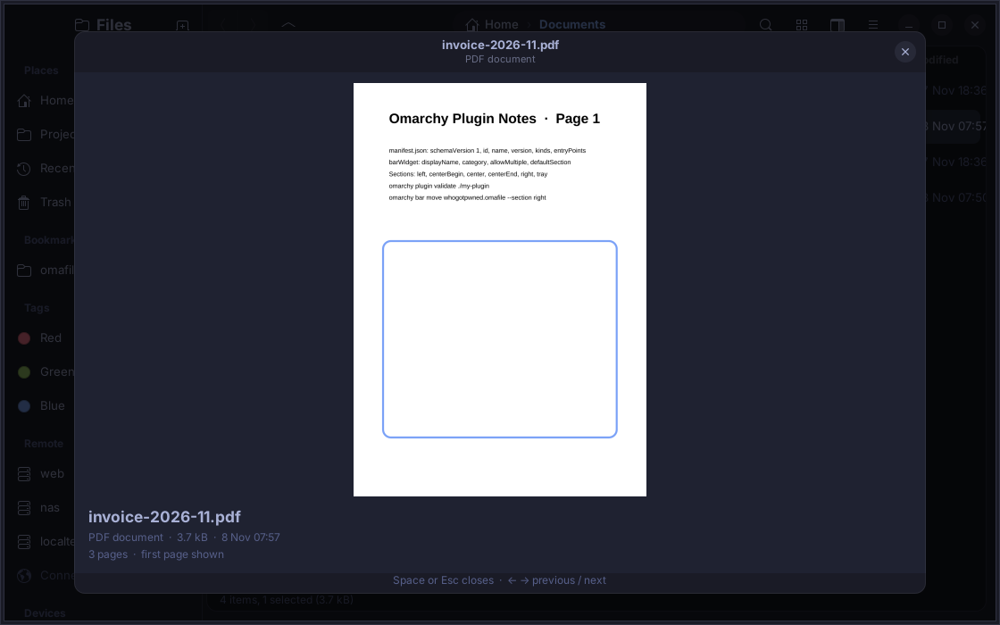 | **Quick Look** (`Space`), as on macOS: a large preview without opening the file. **GIFs and animated WebP play** (a click on the picture pauses; icons in the list stay still), PDFs with page count and **page turning** (`↑`/`↓`, the wheel, or the ‹ › buttons under the page), images, text, folders with item count, git diffs for changed files. `←`/`→` move through the folder, `Space` or `Esc` closes. The **preview pane** (`F3`) is the persistent sidebar version of the same thing; there `Alt+PgUp` / `Alt+PgDn` turn the pages. |
| 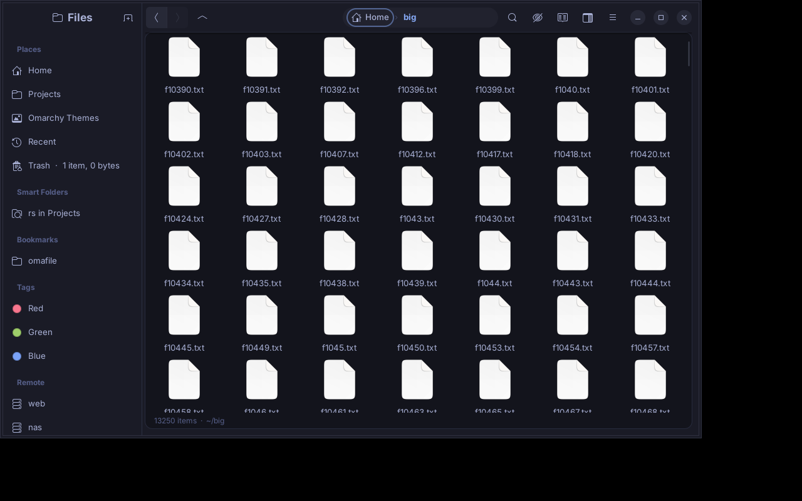 | **Smooth under load**: folders stream in while they are still being listed (a 30k-file folder shows its first rows at once), skeleton rows stand in for slow listings, and a real crossfade carries you from folder to folder. Thumbnails go through the freedesktop cache in `~/.cache/thumbnails` (shared with Nautilus and Loupe), the rows on screen decode first and recycled cells are skipped. Local subfolders are prefetched, the gallery decodes its neighbours ahead, remote listings are cached and a dropped SFTP share is remounted and retried on its own. |
| 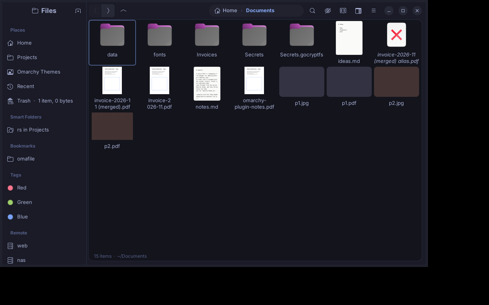 | **Remembered per folder**: list or grid, sort order, grouping and icon size come back when you return to a folder (`~/.config/omafile/views`, Preferences › *Remember view per folder*). **Touchpad**: two-finger swipe goes back and forward, pinch zooms the grid, kinetic scrolling everywhere. **Drag & drop**: the list auto-scrolls near its edges, tabs and breadcrumbs are spring-loaded and accept drops, several items drag as a stack with a count badge. Toasts of the same kind merge instead of stacking, errors carry a *Retry* button, the window title shows the transfer percentage, and every animation obeys the system's reduced-motion setting. |
| 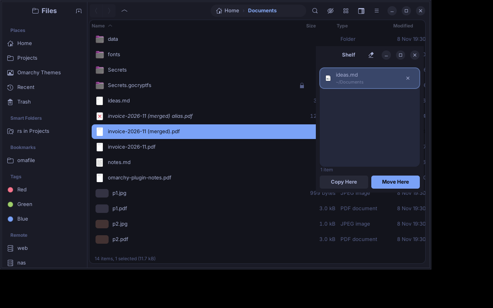 | **Shelf** (`Ctrl+Shift+S`, context menu › *Add to Shelf*, or drop files onto it): a small floating window that collects files from any folder, like Dropover or Yoink. Drag them out together, or *Copy Here* / *Move Here* into the folder omafile shows. The shelf survives a restart (`~/.local/state/omafile/shelf`). `Ctrl+Shift+B` shows or hides it; a Hyprland `windowrule = float, title:^(Shelf)$` keeps it floating. |
| 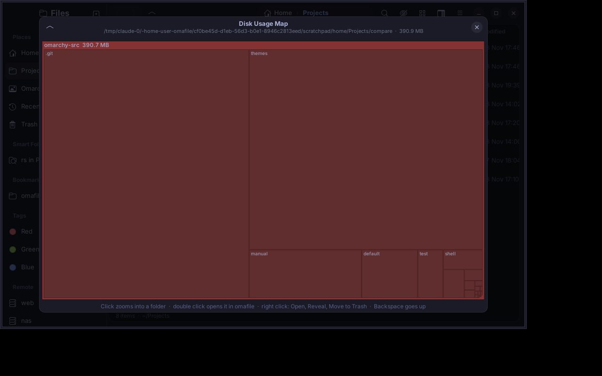 | **Disk usage map** (`Ctrl+Alt+U`, menu, or the context menu of a folder): the folder as a squarified treemap, two levels deep, sizes in every box. Click zooms into a folder, `Backspace` goes up, double click opens it in omafile, right click offers *Open*, *Reveal* and *Move to Trash* (undoable). Scanning runs off the main thread and can be cancelled by closing the dialog. |
| 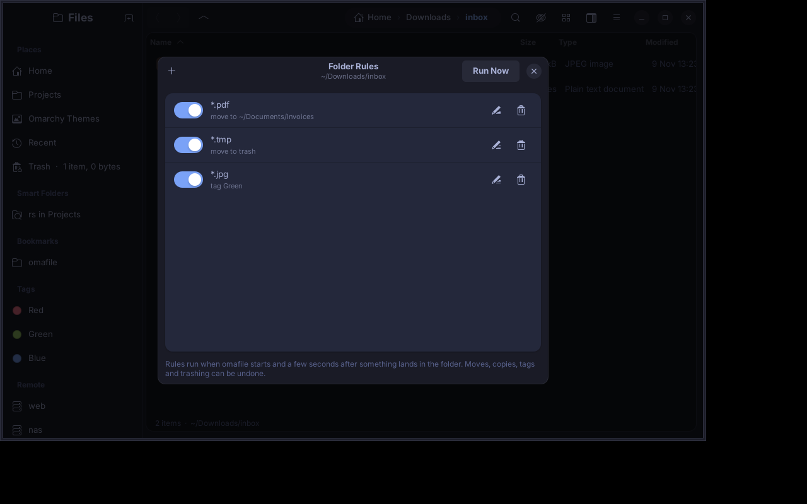 | **Folder rules** (`Ctrl+Alt+R`), Hazel style: for the folder on show, "name matches *.pdf, older than 7 days → move to ~/Documents/Invoices", "*.iso → red tag", "*.tmp → trash", "screenshots → sort into YYYY-MM folders", or "run a command with $FILE". Each rule has a switch; *Run Now* applies them at once. Rules run when omafile starts and a few seconds after something lands in a watched folder; moves, copies, tags and trashing go into the undo journal. Stored in `~/.config/omafile/rules`. |
| 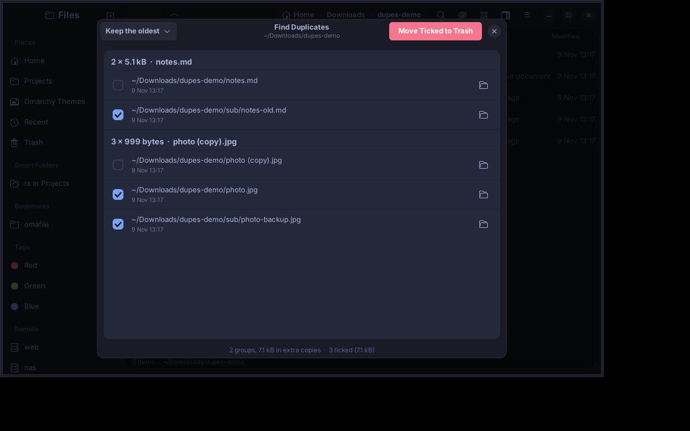 | **Find duplicates** (`Ctrl+Alt+F`): files below the folder with the same size and SHA-256, grouped with the wasted space. One copy per group stays unticked (*keep the oldest / newest / shortest path*), *Move Ticked to Trash* removes the rest in one undoable step. Only size collisions are hashed, so large trees scan quickly. |
| 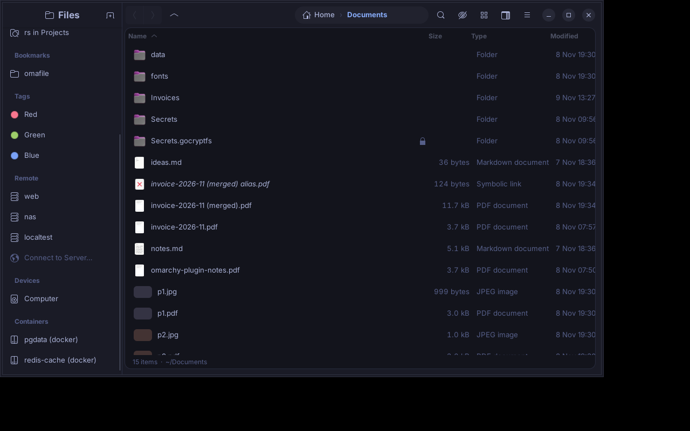 | **Plug it in, it is there**: USB sticks, SD cards, external disks and iPhones appear under *Devices* the moment they are plugged in, are mounted on their own (Preferences › *Mount drives and phones when plugged in*) and get a toast with *Open*. A drive that is not mounted yet shows a + and mounts on click. The eject button on the row (or the context menu) ejects removable media so it is safe to pull; unplugging removes the entry, moves tabs that were inside back home and says so in a toast. Through GVFS, so SMB, SFTP and MTP mounts behave the same. |
| 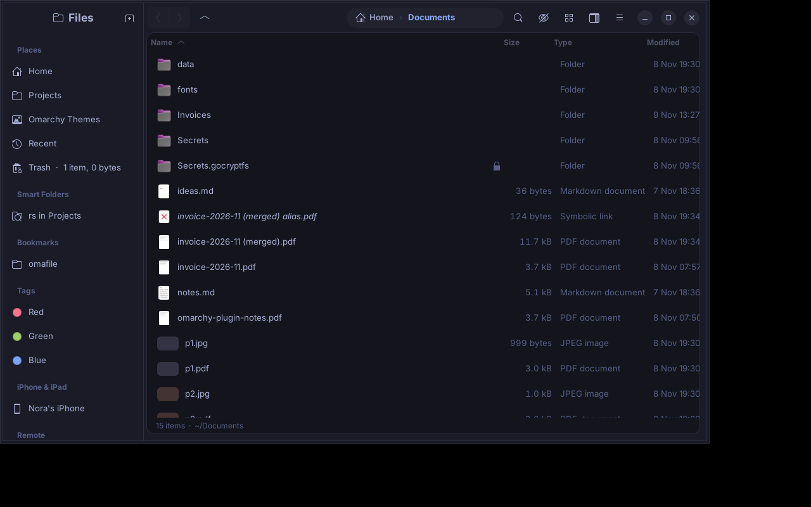 | **iPhone & iPad, three ways.** **Nearby** (`Ctrl+Alt+P`): omafile speaks the LocalSend protocol, so with the free LocalSend app on the phone (Settings › Encryption off) the iPhone appears under *iPhone & iPad* in the sidebar; drop files on it to send them, and files sent from the phone arrive after an *Accept* prompt in `~/Downloads` (or any folder you pick), with a *Show* button on the toast. **USB**: with `gvfs-afc` the phone mounts like a drive; *Import Photos* copies the camera roll into `Pictures/iPhone/YYYY-MM`, converts HEIC to JPEG (libheif or ImageMagick), skips what was imported before, undoable; also `omafile --import-photos` and the bar menu. **No app at all**: *Share on Local Network* now serves a phone-friendly page with the selection to download **and** a drop zone / picker that sends photos straight into the folder on show; scan the QR code with the camera. Omarchy's firewall lets only port 53317 in (it is opened for LocalSend), so omafile listens there and serves the share page on the same port under a private path; nothing has to be opened by hand. |
| 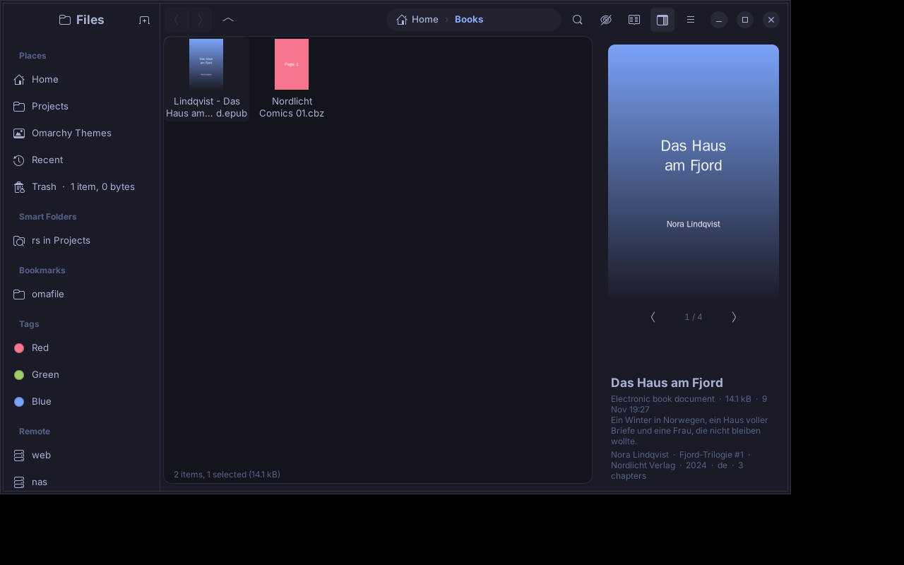 | **eBooks**: EPUB, comic archives (CBZ / CBR) and FictionBook show their **cover** in list, grid and preview, the preview and Properties list title, author, series, publisher, year, language, ISBN and chapter count, and the page turner pages from the cover into the **chapters** (text) or comic pages (`↑` `↓` in Quick Look). Context menu › *eBook*: *Open in Reader* (foliate, Calibre viewer, KOReader, Okular), *Rename from Metadata* (`Author - Title (Series 1).epub`, undoable), *Send to eReader* (Kindle `documents/`, Kobo, Tolino, PocketBook… when plugged in) and *Convert to* EPUB / MOBI / AZW3 / PDF with Calibre's `ebook-convert`. Covers go through the shared thumbnail cache; everything is read with `bsdtar`, no Calibre needed for reading. |
| 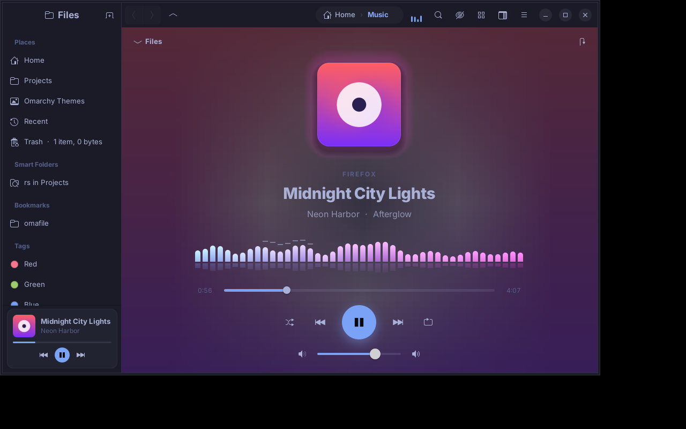 | **Now Playing** (`F8`): whatever plays on this computer, be it a YouTube tab in the browser, Spotify or mpv (anything that speaks MPRIS), shows up in omafile. While a player exists, a small **live equalizer** sits in the header and a **mini player** at the bottom of the sidebar (cover, title, its own equalizer, previous / play-pause / next, progress). Everything moves: the mini player slides up and glows once when music starts, the cover cross-fades between tracks and nods with the bass, buttons bounce, and both slide away when the player quits. `F8` or a click slides in the **full view**: the cover with a halo that breathes with the bass over a backdrop in the cover's colours, a 44-band **spectrum** with falling peaks and a reflection, seek bar, shuffle, repeat, volume, a chooser when several players run and a button that brings the player to the front. Keys there: `Space` play / pause, `←` `→` seek, `↑` `↓` volume, `N` / `P` next / previous, `Esc` back to the files. The spectrum follows the real sound through `parec` / `pw-record` (only while the view is open, nothing is stored) and falls back to a generated animation; both can be switched off in Preferences › Now Playing. 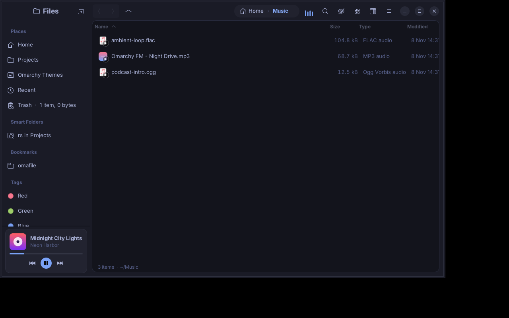 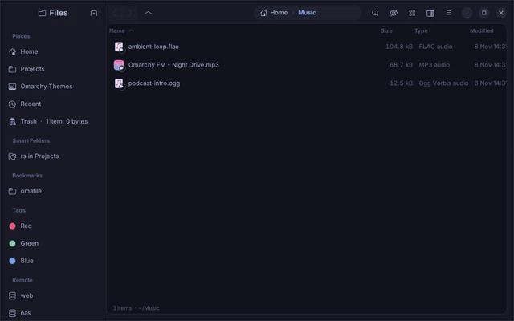 |
| 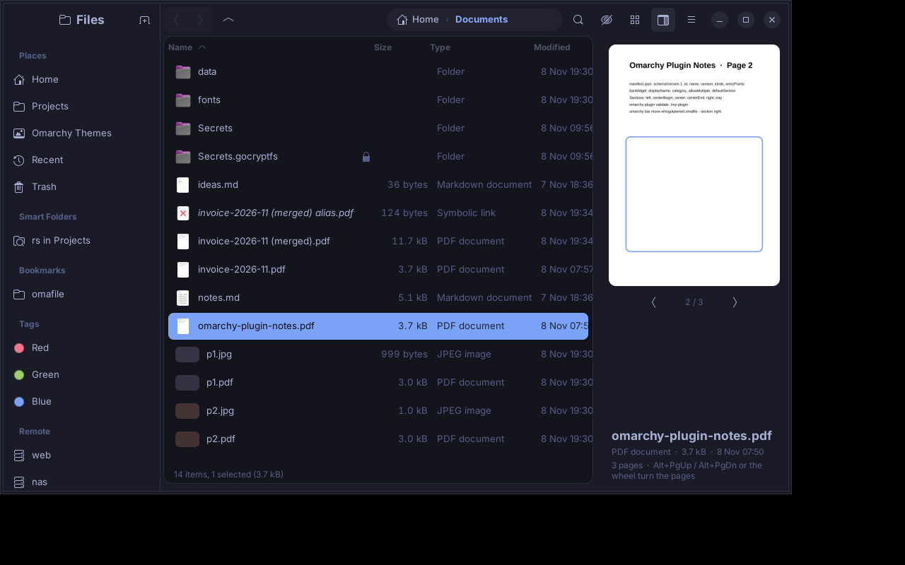 | **Multi-page documents**: a `‹ 2 / 3 ›` turner appears under the page in the preview pane and in Quick Look. Pages render on demand through poppler at the pane's resolution, so flipping through a long PDF never blocks the list. |
| 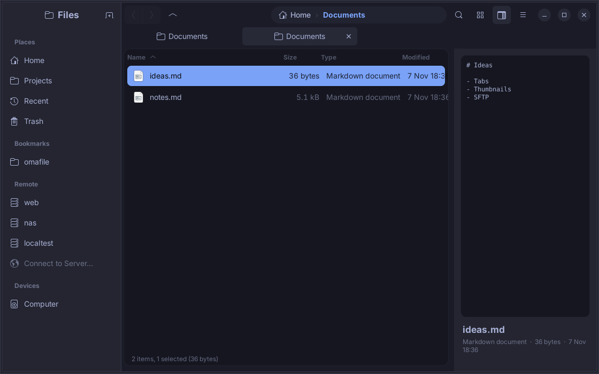 | **Tabs** (`Ctrl+T`), **split view** (`F6`) with two sets of tabs and their own histories, drag files across sides or between a local and a remote tab. **Sessions** bring tabs, split, open terminal panels and window size back on the next start. |
| 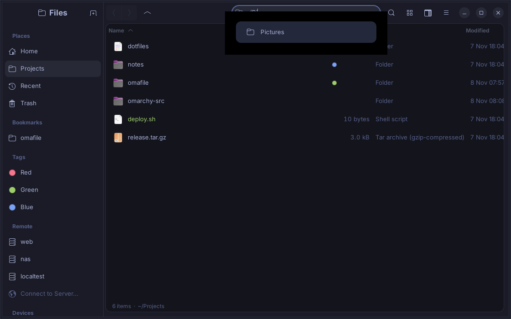 | **Editable path bar** (`Ctrl+L`): the breadcrumb becomes a text field with the cursor at the end, folders complete as you type (`Tab` accepts, `↑`/`↓` pick, `Enter` opens). `~`, relative paths, `sftp://` and `user@host` all work. |
| 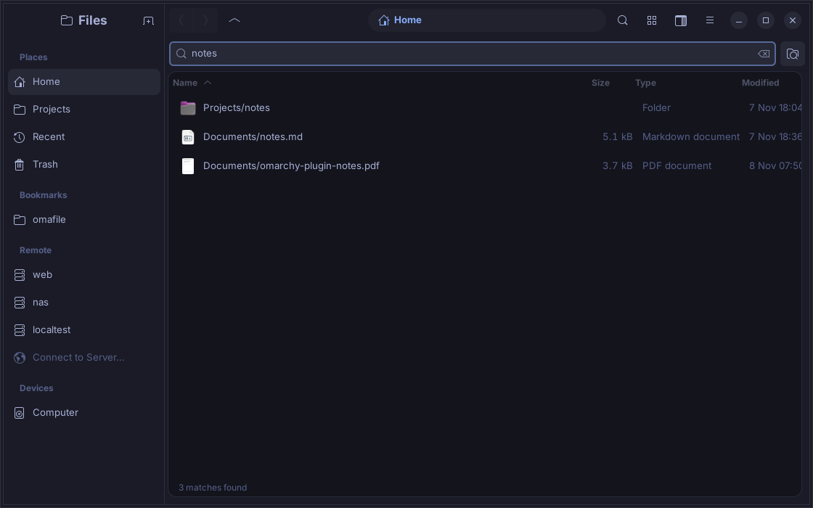 | **Recursive search** (`Ctrl+Shift+F`): `fd` streams matches while it walks, results arrive in batches, the previous search is killed as you type on, and the final list is ranked. About 40 ms for a short query on a 5,300-file tree. **Smart folders** (`Ctrl+Alt+S`) save a search with glob and age as a sidebar entry. |
| 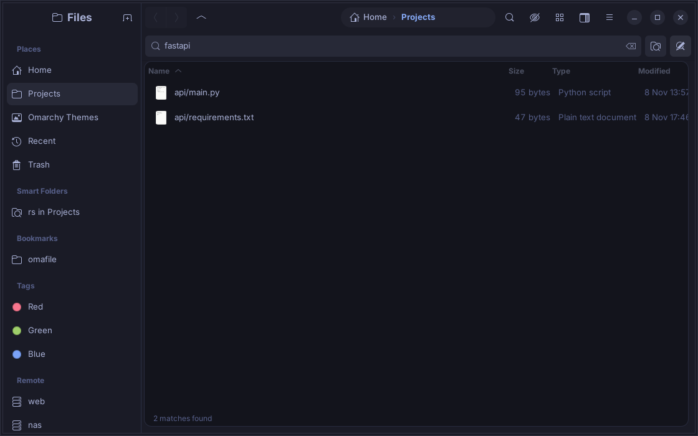 | **Full-text search**: the second toggle in the search bar hands the query to `ripgrep`, so you find the files that *contain* the words, streamed the same way (`.git` skipped, 8 MB per file cap). |
| 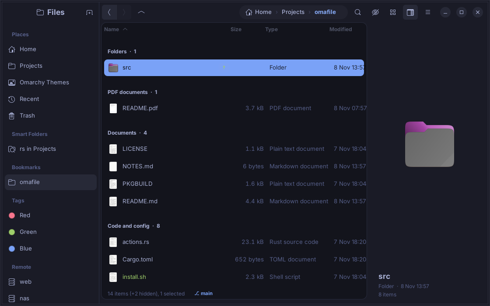 | **Quick Look renderers**: source code with syntax highlighting (`bat`), Markdown with headings, lists, links and code, CSV / TSV as an aligned table, JSON formatted by `jq`, font files as a specimen (ImageMagick). Plain text stays plain. |
| 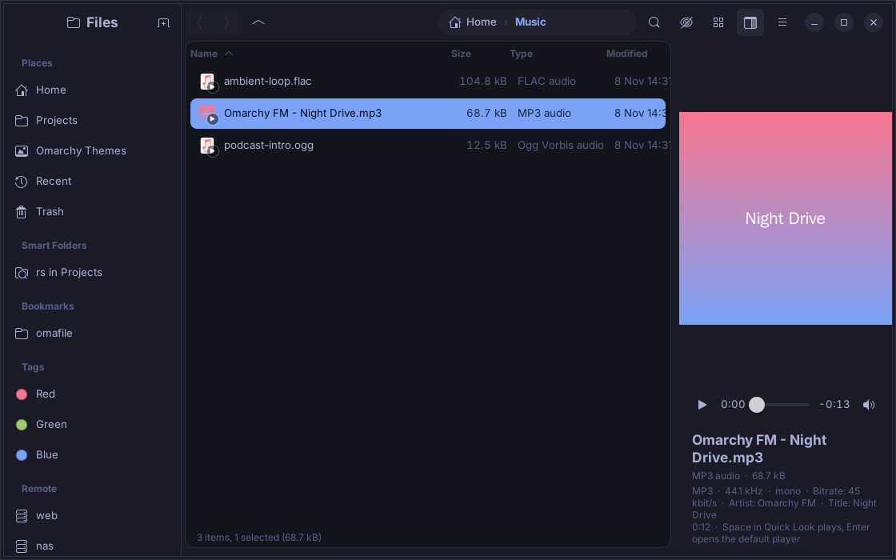 | **Metadata where you look**: images show dimensions, format, camera, date taken and exposure (EXIF); audio and video show codec, sample rate, channels, resolution, frame rate, bitrate and tags, in the preview, Quick Look and the *Media* group of Properties. |
| 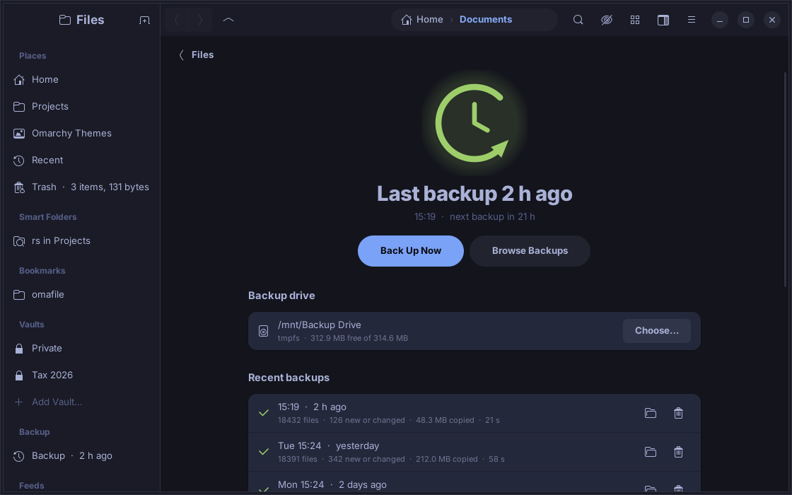 | **Backup to another drive** (`Ctrl+Alt+K`), Time Machine style. The sidebar has a **Backup** row that always says when the last backup ran (*Backup · 2 h ago*), shows the percentage while one runs and turns into a warning when backups are overdue or failed. The page behind it shows the status with the clock and its arrow (it turns while a backup runs), the **drive** with its free space, the **recent backups** with what each one copied, and the settings: which folders (your home folder by default), what to leave out (caches, the trash and build folders by default; your own names and folders), and **how backups are made**: hourly, daily, weekly or only by hand, at which **time of day** and on which day, **only on mains power**, **how long backups are kept** (a month to a year, or as long as there is room), whether the oldest make room when the drive runs full, and a notification when one has finished. Every backup is a **complete folder tree** you can open and copy from; files that did not change are hard links to the backup before and take no space. Old backups thin out by themselves: all of the last day, one a day for a month, one a week beyond. A **systemd user timer** asks every ten minutes whether a backup is due, also when omafile is closed; one that could not run (computer off, drive away, on battery) is made up for as soon as it can (omafile recognises the drive by its file system, wherever it gets mounted). An interrupted backup is continued, not started over. *Earlier Versions* reads the backups too, so a file can be restored from the drive with the same dialog. The page warns when the destination is on the same disk as your files, and when it is formatted as FAT / exFAT (no hard links: every backup is a full copy). No rsync, no extra tool: the copying is built in. **Next to Omarchy, not across it:** Omarchy snapshots the *system* before every update (snapper, root only, a handful, on the same disk) and leaves `/home` alone on purpose; this backup is the other half, your own files on another drive with a history. Snapshot folders are never copied, omafile never calls snapper or touches Omarchy's snapshots, and the page says who looks after what and when the last system snapshot was made. Beside each backup lie `packages.txt` and `packages-aur.txt`: fresh Omarchy install + home folder from the backup + `sudo pacman -S --needed - < packages.txt` and the computer is back. 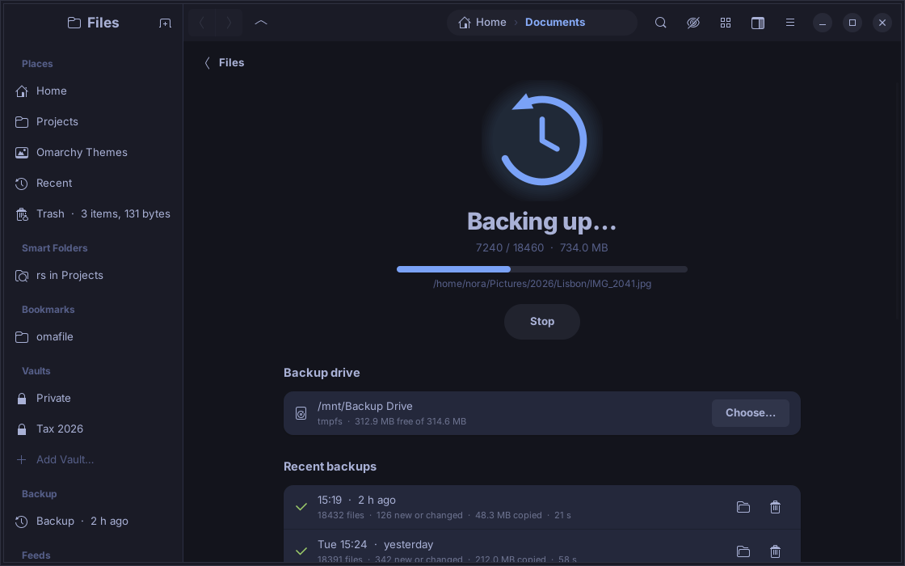 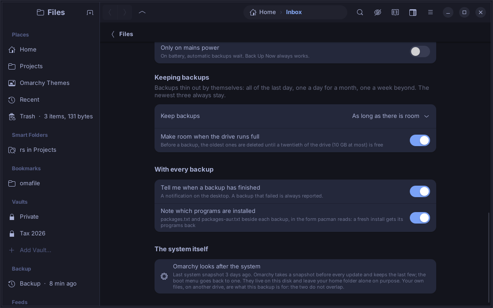 |
| 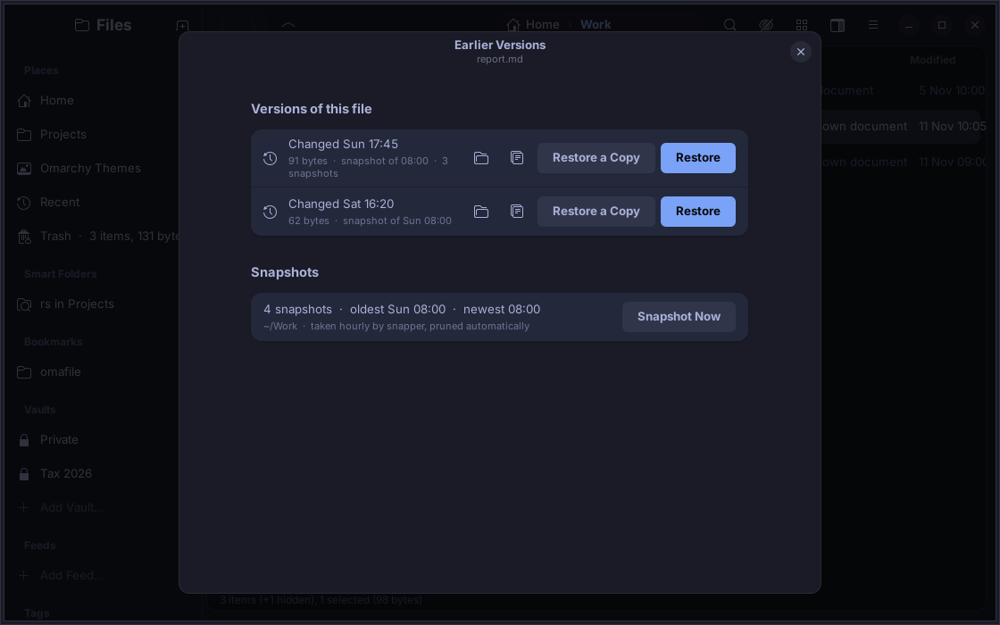 | **Earlier versions** (`Ctrl+Alt+H`): Omarchy snapshots the system with snapper so an update can be rolled back, and leaves `/home` alone on purpose. omafile fills that gap the other way round: with **hourly Btrfs snapshots of your home folder**, every file keeps its history, and single files are copied back out of a snapshot; nothing is ever rolled back. For a file the dialog lists its distinct earlier states (told apart by size and date, however many snapshots hold them) with *Compare* against the current one, *Restore a Copy* (placed next to it with the date in its name) and *Restore* (in place; what was there goes to the trash). For a folder it lists the snapshots to look into (read-only) or compare with now, and everything that was **deleted from the folder** with a *Restore* button each. *Snapshot Now* takes one before a risky change. Turning it on is one dialog: it explains what happens, shows the exact commands (a snapper configuration for the subvolume, an hourly timeline pruned automatically, read access for your user) and runs them in a terminal, where `sudo` asks for your password once. Works wherever snapper keeps snapshots, not only for `/home`. 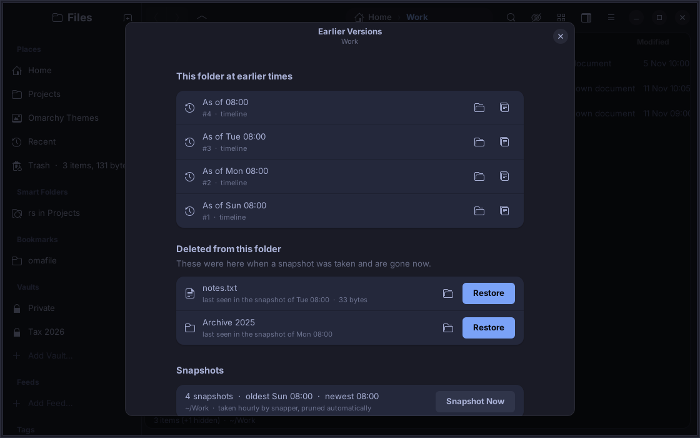 |
| 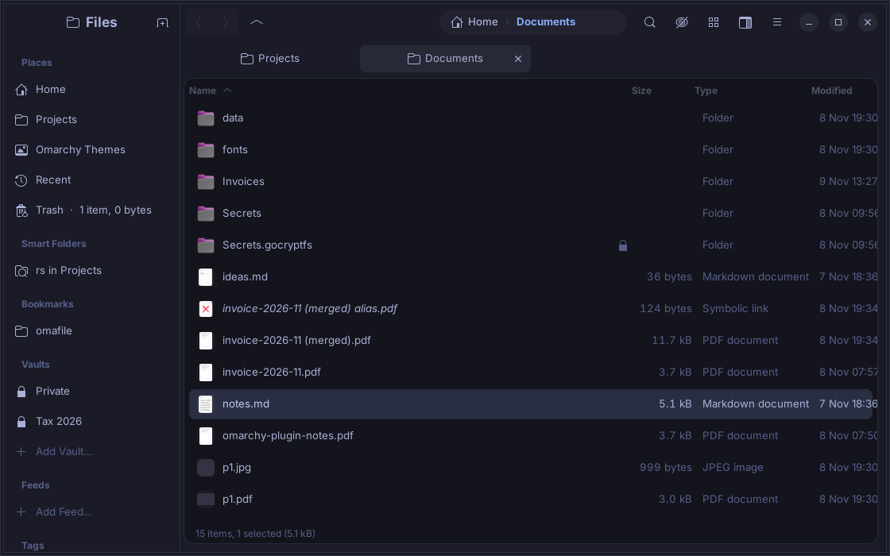 | **The system's file manager**: omafile answers `org.freedesktop.FileManager1`, the D-Bus interface behind *Show in folder* in browsers, download managers and editors: the folder opens in a new tab with the file selected (or its properties, when the program asks for those). Preferences › Default file manager › *Make Default* also opens folders from other programs in omafile and writes a small D-Bus service file into your own data directory, so that *Show in folder* starts omafile when it is not running; *Undo* puts the previous file manager back. While files are being copied or moved omafile holds a **sleep and idle inhibitor** with systemd-logind (hypridle honours it), so a long transfer is not cut short by suspend. |
| 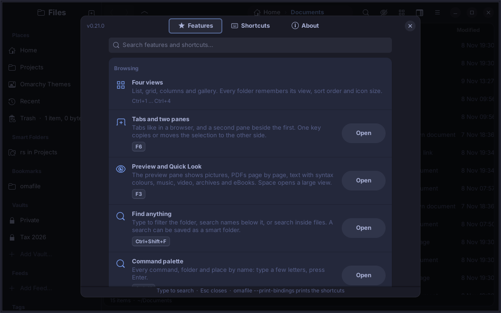 | **Help** (`F1`): one dialog with three pages and one search field. **Features** is a tour of what omafile can do, grouped by area; every entry says how to reach it (its shortcut or the menu it lives in) and, where nothing can go wrong, has an *Open* button that takes you there. **Shortcuts** is the full list of bindings. **About** shows the **version**, what is new in it (taken from the changelog built into the program), which optional tools were found on this computer with a tick or a cross, and where settings, state and caches are kept. The version is also in the corner of the dialog and in `omafile --version`. 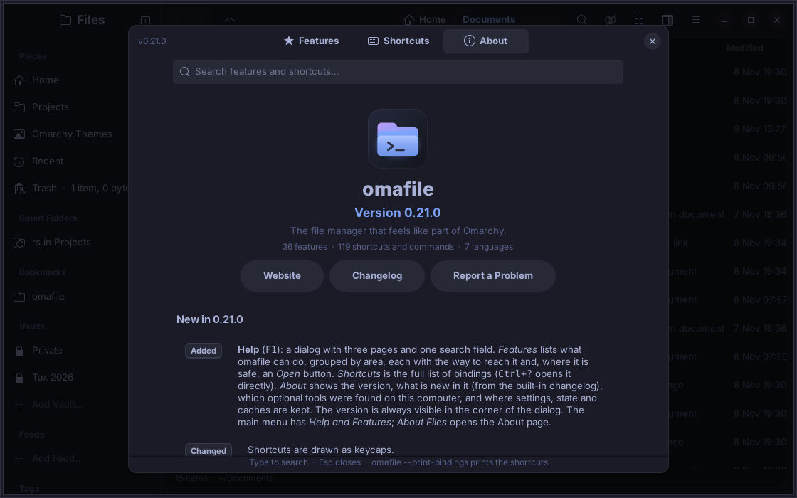 |
|  | **All bindings in one place** (`Ctrl+?`, or the *Shortcuts* page of Help): a searchable overlay of every shortcut, gesture and menu entry with keycaps, starting with the Hyprland key that opens omafile. Generated from the accelerator table, kept complete by a test, printable with `omafile --print-bindings`. |

### Files and operations

| | |
|---|---|
| 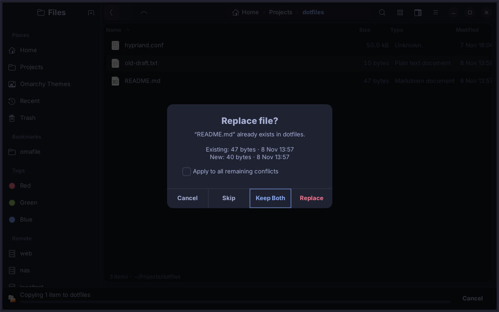 | **One queue for everything**: paste, drop, Copy To, Move To and dual-pane commands share a queue with a progress banner and *Cancel*. An existing target asks *Replace*, *Skip*, *Keep Both* or *Cancel*, with sizes and dates and *apply to all*. Folders copy file by file so cancelling and progress work for them too. |
| 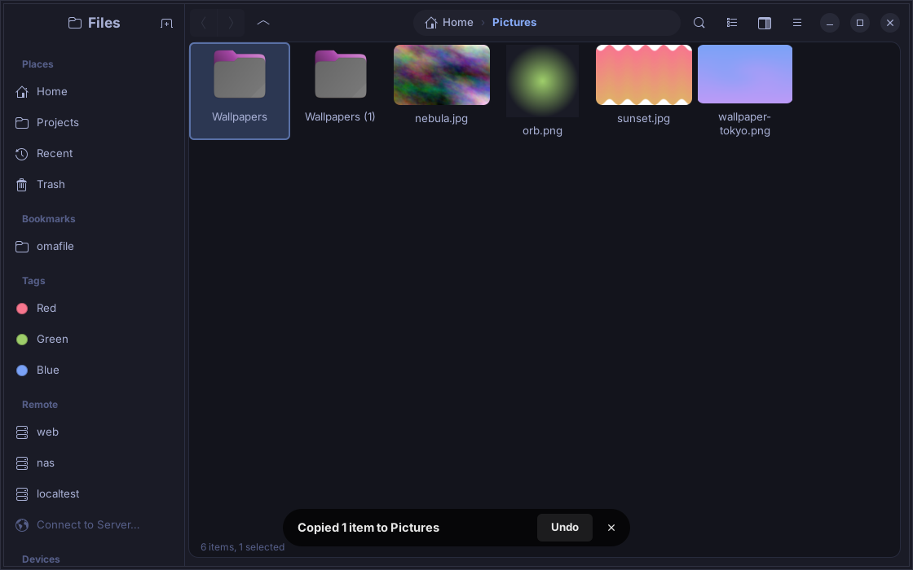 | **Undo and redo** (`Ctrl+Z`, `Ctrl+Shift+Z`) for move, copy, paste, rename, batch rename, duplicate, new items, trash, tags, permissions, ownership, image conversions and templates. Every toast carries an Undo button. |
| 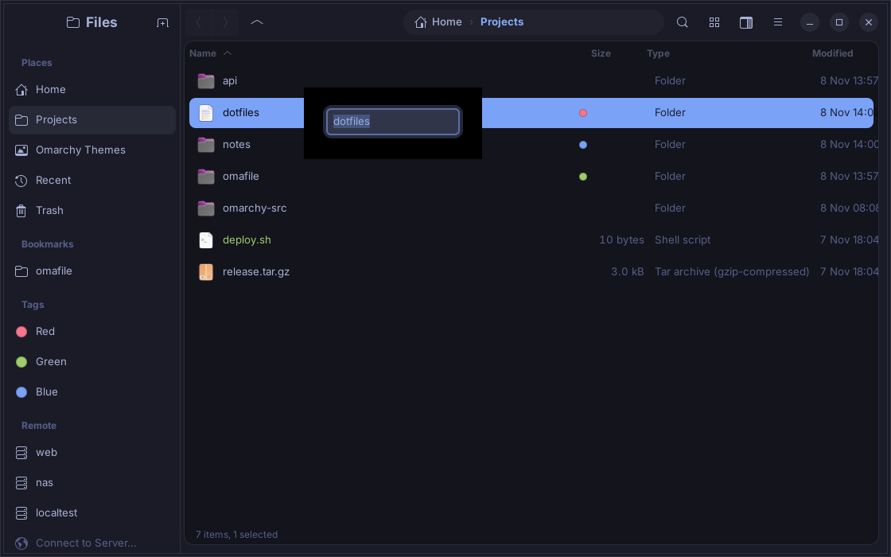 | **Rename in place** (`F2`) with the stem preselected, `Shift+F2` for the dialog. **Batch rename** on a multi-selection: `[name]`, `[ext]`, `[N]` / `[N:3]`, `[date]`, `[exif]`, `[artist]` `[title]` `[album]` `[track]`, plain or regex find/replace with `$1`, live preview and conflict detection. |
| 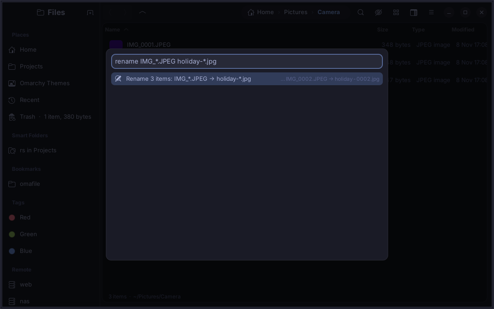 | **Bulk commands in the palette**: `rename *.jpeg *.jpg`, `rename IMG_* holiday-*`, `chmod +x`, `touch a b`, `mkdir docs` typed into `Ctrl+K`. The row previews the effect, `Enter` runs it, `*` captures and reinserts, all undoable. |
| 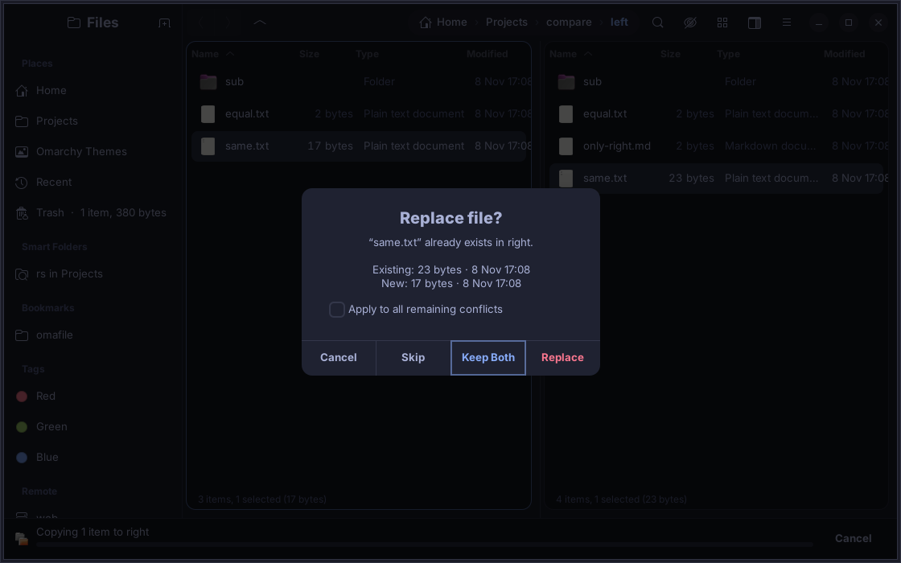 | **Dual-pane commands**: in split view `Shift+F5` copies and `Shift+F6` moves the selection to the other side, Midnight Commander style. |
| 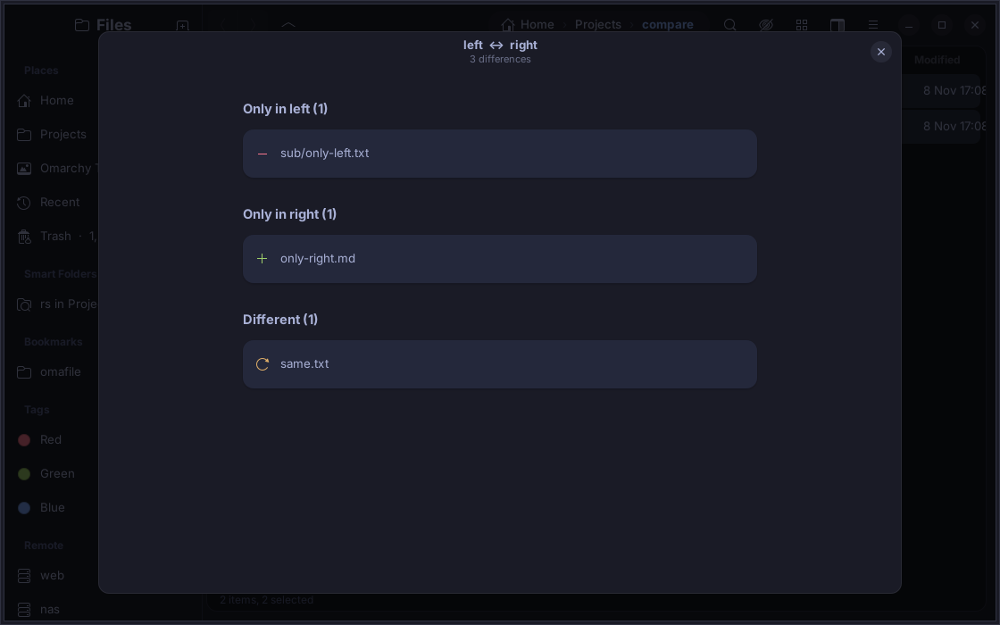 | **Compare** (`Ctrl+Alt+D`): two files give a coloured unified diff, two folders a report of only-left, only-right and different. One item on each side of the split works too. |
|  | **Trash with memory**: columns for deletion date and original location, `Ctrl+Shift+R` restores. The sidebar entry shows count and size, Preferences can delete items older than N days, and a drive below 5 % or 2 GB free gets a warning. |
|  | **Folder sizes** (`Ctrl+Shift+U`) measured in the background and sorted by disk usage; Properties calculates a folder's size too. |
|  | **Archives in place**: `Enter` on a `.zip` / `.tar.*` browses inside it through GVFS, *Extract Here* and *Compress…* stay in the menu. |
|  | **Image tools**: rotate, convert to PNG / JPEG / WebP, resize by width, height or percent, set as Omarchy wallpaper. New files are written next to the original and can be undone. |
|  | **Checksums**: SHA-256 in Properties with a copy button; *Verify Checksum* compares against a `.sha256` / `SHA256SUMS` sidecar or a hash on the clipboard and says ✓ or ✗. |
|  | **Permissions and ownership in plain words**: Properties explains who may read, write and run, shows `rw-r--r--` and `644`, and lets you change it with check boxes, an octal field, special-bit switches, a group picker and (as root) an owner picker. Folders get *Apply to Enclosed Files*. |
|  | **Properties for several items**: count, folders and files, total size (folders measured), kinds and shared tags, as "Get Info" on a multi-selection. |
|  | **Always Open With…**: pick an application for this file type and make it the default, applications that claim the type first. **Make Alias** creates a symbolic link next to the original, **Show Original** jumps to a link's target. **New Folder with Selection** (`Ctrl+Shift+M`) wraps the selected items into a new folder. |
|  | **PDF quick actions**: images → PDF, merge selected PDFs, split into pages, extract a page range (poppler, ImageMagick). **Video / Audio**: trim without re-encoding, make a GIF of the first ten seconds, extract the audio track, convert to MP3 / Opus / FLAC (ffmpeg). All outputs are new files, undo trashes them. |
|  | **Spring-loaded folders**: hover a folder (or a sidebar place) while dragging and it opens after a moment, so a drop can go several levels deep in one move. **macOS keys** in Preferences: `Enter` renames, `Ctrl+O` / `Ctrl+↓` opens, `Ctrl+↑` goes up. |
|  | **Vim keys** (Preferences › Keys): `h` parent, `l` open, `j` / `k` move, `gg` / `G` first and last, `/` filter, `:` palette, `dd` trash, `yy` / `p` / `x` copy, paste, cut, `u` undo. One master switch, one switch per group, so `hjkl` can stay on while `dd` stays off. They act only while the file list has focus; text fields and the terminal never see them. |
|  | **New from Template**: `~/Templates` entries plus built-in scaffolds for a Rust crate, a Python project, an Omarchy shell plugin, a Hyprland snippet and a static web page. |

### Developer

| | |
|---|---|
|  | **Terminal panel** (`` Ctrl+` `` or `F7`): your login shell in a VTE terminal docked under the files. It opens in the folder you look at and follows along; with fish, zsh or an OSC 7 bash prompt a `cd` in the terminal moves the file view too. Same colour mapping Omarchy applies to Alacritty, `Ctrl+Shift+C`/`V`, one terminal per tab. |
|  | **Git awareness**: status badges per row (`M` `?` `A` `D` `!`), folders inherit the strongest state, status line with `repo on branch · 1 modified · 2 untracked` and a branch button. |
|  | **Git without a terminal**: click a badge to stage or unstage, *Git › Stage / Unstage / Discard Changes…*, *Commit…* (`Ctrl+Alt+C`) with summary and body, branch switcher (`Ctrl+Alt+B`) that creates branches too. Errors arrive as one-line toasts. |
|  | **Diff preview**: changed files show their coloured `git diff` in the preview pane and Quick Look, index diff appended, `+`/`−` count underneath. |
|  | **Command palette** (`Ctrl+K`): fuzzy search over actions with their shortcuts, places, bookmarks, recent folders, SSH hosts, notes, templates and the project commands of the current folder. `> cargo test` runs anything in a terminal. |
|  | **Project actions** for Cargo, npm, Python, Go, PKGBUILD, compose, Make / just, Omarchy plugins and git checkouts, plus your own from `.omafile.toml`. *Open in Editor* (`Ctrl+E`) uses `omarchy-launch-editor`. |
|  | **Python virtual environments**: `.venv` / `venv` / `env` are recognised by `pyvenv.cfg` and show a flask badge with Python version, package count and tool (uv, virtualenv, venv); the status line summarises them. The terminal panel activates the venv when you enter the project and deactivates when you leave (`Ctrl+Alt+V` by hand, switchable in Preferences). |
|  | **Requirements at a glance**: `requirements.txt` and `pyproject.toml` list every requirement with ✓ version or ✗ missing against the venv. *Python* menu: Create venv (`uv venv`, else `python -m venv`), Install Requirements, Freeze, REPL, Add to .gitignore, Recreate; *Run in venv* on `.py` files. Moving a venv warns that it must be recreated. |
|  | **Container volumes**: Docker and podman volumes whose mount point you can read appear under *Containers* (rootless podman always; Docker's live under `/var/lib/docker`, root-only). |

### Security and privacy

| | |
|---|---|
|  | **Encrypted folders** with gocryptfs: *New Encrypted Folder…* creates `Name.gocryptfs` (ciphertext) next to `Name` (plaintext while unlocked). Unlock, lock, change password from the context menu; the password only travels through a pipe; the master key is shown once. The `.gocryptfs` folder is the thing to back up or sync. Details [below](#encrypted-folders-in-detail). |
|  | **Vaults in the sidebar**: any number of encrypted folders, each with its own master password, listed under *Vaults*. *Add Vault…* creates a new one (name, place, password; `~/Vaults` unless you choose another folder, a USB stick works too) or lists one that exists already. A click on a locked vault puts a **large padlock** where the files would be and asks for the master password: a wrong one makes it shake its head, the right one swings the shackle open and the files appear. Unlocked vaults show a green open padlock and a button that locks them again; tabs inside step out first. Right click: change password, show the encrypted data, remove from the sidebar (the data stays). Files cannot be dropped on a locked vault. **Take it along**: *Export…* writes the vault into one file, `Name.gocryptfs.tar`; nothing is decrypted on the way, so the file is protected by the same master password. On the other computer *Add Vault… › Import from File…* (or *Import as Vault…* on the file) unpacks it into `~/Vaults` and shows its padlock. No password or key is stored, only the list of folders.  |
|  | **Secrets protection**: `.env`, `id_rsa`, `*.pem`, `*.key`, `*.p12`, `*.kdbx`, `credentials.json`, `.netrc`, `.npmrc`, `kubeconfig`, … get a key badge, a masked preview and a confirmation before they are copied. `.env.example` and `*.pub` are exempt. |
|  | **Share** on your terms: *Copy scp Command*, or *Share on Local Network…* serves exactly the selection over HTTP from a scratch folder of links with a QR code, until you close the dialog. |

### Organise

| | |
|---|---|
|  | **Tags**, Finder style: seven colours (`Ctrl+Alt+1…7`, `Ctrl+Alt+0` removes), dots in list and grid, each colour in use becomes a sidebar listing. Stored as GIO metadata plus an index, follow renames and moves. |
|  | **Notes on files** (`Ctrl+Alt+M`): the same metadata field Nautilus uses, a speech-bubble badge with tooltip, searchable in the palette, which jumps to the file. |
|  | **Custom icons** per folder or file (`Ctrl+Alt+I`) from the icon theme or your own image; Nautilus shows the same icon. |
|  | **Smart folders**: saved searches with name, root, glob and age under *Smart Folders* in the sidebar, newest matches first. |
|  | **Sessions**: tabs, split, terminal panels and window size return on the next start (`omafile` without arguments). Off in Preferences if you prefer a clean window. |

### Omarchy and remote

| | |
|---|---|
|  | **Omarchy themes**: an *Omarchy Themes* place, theme folders with their `preview.png` as thumbnail, *Apply Omarchy Theme* (`omarchy-theme-set`), *Set as Wallpaper* (`omarchy-theme-bg-set`), *Export Omarchy Theme…* to `~/Downloads/<name>.tar.gz` and *Install as Omarchy Theme* from such an archive. |
|  | **Theme following**: the same build after `omarchy theme set "Catppuccin Latte"`, light window and blue folders without a restart. |
|  | **SFTP / SCP**: hosts from `~/.ssh/config` in the sidebar, *Connect to Server…* for `user@host[:port]/path`, native credential prompts, mounted servers under *Devices*. Copy, paste, drag and drop, rename and preview work on remote files like on local ones. |
|  | **Servers the WinSCP way**: connecting splits the view, **local on the left, the server on the right**. Two arrows in the header copy or move the selection across (they point at the other pane; `Shift+F5` / `Shift+F6`), dragging works too, conflicts ask as usual. *Connect to Server…* takes a name and a password: **saved connections** appear under *Remote* in the sidebar (right click: Connect, Open in New Tab, Edit…, Remove). The **password goes to the system keyring** (the Secret Service, e.g. GNOME Keyring, encrypted with your login) through GVFS, never into omafile's own files; the next connect does not ask, and *Remove* deletes it from the keyring again. SSH keys work without any of that. An alias from `~/.ssh/config` may be followed by a path (`web/srv/www`). The two-pane behaviour can be switched off in Preferences › Servers. |
|  | **Feeds** (`Ctrl+Alt+W`): RSS and Atom news to read where the files are. *Add Feed…* in the sidebar takes the address of a feed or simply of a site (omafile follows the page's feed link). Each feed shows its number of unread articles; *All Articles* merges them by date. The reader has the list on the left and the article on the right: lead picture, headings, emphasis, lists, quotes, code and links survive, scripts and trackers do not (no web engine is involved). `↑` `↓` or `J` `K` step through, `O` opens the page in the browser, `M` marks unread, `R` fetches, `Space` scrolls, `Esc` returns to the files. Feeds are fetched with `curl` (http and https only) shortly after start and twice an hour, kept on disk for offline reading. |
|  | **Preferences** (`Ctrl+,`): icon theme override, thumbnails, default view, hidden files, session restore, archives in place, venv activation, trash auto-empty. |

Also: *Copy To…* / *Move To…* with a folder picker, *Duplicate* (`Ctrl+Shift+D`), bookmarks shared with the GTK file chooser (`Ctrl+D`), *Recent*, drag and drop onto sidebar places, cut/copy/paste shared with other apps, *Open With…*, copy path, open a terminal window here, and `omafile --toggle` for a Hyprland drop-down window.

<details>
<summary>More screenshots</summary>

Context menu · Connect to Server · custom folder icon · vault menu · a tag listing · Quick Look playing music · compare two files · Python menu


</details>

### Motion

Panels move the way the rest of Omarchy moves instead of snapping: the terminal panel slides up and down, the split view slides its divider in from the right, a new folder cross-fades over the old one (the previous view is frozen and fades out), slow listings show pulsing skeleton rows, thumbnails cross-fade over their icon, hover and selection colours ease. libadwaita animations with an ease-out-quint curve over about 260 ms; `gtk-enable-animations` (reduce motion) switches every effect off at once.

---

## Keyboard shortcuts

`Ctrl+?` opens the full, searchable list inside omafile (it is the *Shortcuts* page of Help, `F1`). `omafile --print-bindings` prints it for scripts. The essentials:

| Keys | Action |
|---|---|
| `Alt+←` `Alt+→` `Alt+↑` `Backspace` | Back, forward, parent |
| `Ctrl+L` | Edit the path; `Tab` completes folders |
| `Ctrl+F` / `Ctrl+Shift+F` | Filter this folder / search subfolders |
| `Ctrl+K` | Command palette (actions, folders, `> command`, bulk `rename` / `chmod` / `touch` / `mkdir`) |
| `Ctrl+T` `Ctrl+W` `Ctrl+Tab` `Ctrl+Enter` | New, close, next tab, open folder in new tab |
| `F3` `F6` `F9` | Preview pane, split view, sidebar |
| `` Ctrl+` `` / `F7` | Terminal panel |
| `Ctrl+1` `Ctrl+2` `Ctrl+3` `Ctrl+4` | List, grid, columns, gallery |
| `Ctrl+Plus` `Ctrl+Minus` `Ctrl+0` | Grid icon size (also Ctrl+scroll) |
| `Ctrl+H` | Hidden files |
| `Space` | Quick Look (plays music); `←` `→` walk the folder, `↑` `↓` turn PDF pages |
| `Alt+PgUp` / `Alt+PgDn` | Previous / next PDF page in the preview pane (also the wheel over the page) |
| `Enter` `Ctrl+Shift+O` `F4` `Ctrl+E` | Open, open with…, terminal here, open in editor |
| `Ctrl+Shift+N` `Ctrl+Alt+N` `Ctrl+Shift+M` | New folder, new file, new folder with selection |
| `F2` / `Shift+F2` | Rename in place / dialog; batch rename with several selected |
| `Ctrl+C` `Ctrl+X` `Ctrl+V` `Ctrl+Shift+C` `Ctrl+Shift+D` | Copy, cut, paste, copy path, duplicate |
| `Shift+F5` / `Shift+F6` | Copy / move to the other pane of the split |
| `Delete` `Shift+Delete` `Ctrl+Shift+R` | Trash, delete permanently, restore |
| `Ctrl+Z` `Ctrl+Shift+Z` | Undo, redo |
| `Ctrl+Shift+U` / `Ctrl+Alt+U` | Folder sizes / disk usage map |
| `Ctrl+Alt+F` `Ctrl+Alt+R` | Find duplicates, folder rules |
| `Ctrl+Shift+S` / `Ctrl+Shift+B` | Add the selection to the shelf / show or hide the shelf |
| `Ctrl+Alt+P` | Nearby devices (LocalSend): send the selection to a phone, receive settings |
| `Ctrl+Alt+W` | Feeds: read the news (in the reader: `J` `K`, `O`, `M`, `R`, `Space`, `Esc`) |
| `Ctrl+Alt+H` | Earlier versions of the selection or the folder (Btrfs snapshots) |
| `Ctrl+Alt+K` | Backup: status, the last backups, drive, schedule and settings |
| `F8` | Now Playing: full media view (in it: `Space`, `←` `→`, `↑` `↓`, `N` / `P`, `Esc`) |
| `Ctrl+Alt+C` / `Ctrl+Alt+B` | Git commit / switch branch (click a badge to stage) |
| `Ctrl+Alt+D` `Ctrl+Alt+M` `Ctrl+Alt+S` `Ctrl+Alt+V` | Compare, note, save smart folder, activate venv |
| `Ctrl+Alt+1…7` / `Ctrl+Alt+0` `Ctrl+Alt+I` | Tags, remove tag, change icon |
| `Ctrl+D` `Ctrl+Shift+K` `Ctrl+I` | Bookmark, connect to server, properties |
| `Ctrl+,` `F1` `Ctrl+?` `Ctrl+Q` | Preferences, help (features, version), all bindings, quit |
| `h` `j` `k` `l` `gg` `G` `/` `:` `dd` `yy` `p` `x` `u` | **Vim keys**, off by default: Preferences › Keys turns them on, group by group |

Every shortcut is exercised by an automated run under Xvfb (`OMAFILE_TRACE=1` logs each action). Shortcuts that also mean something in a text field act on the text while a field has focus and on files otherwise.

## Command line and launchers

```
omafile [FOLDER…]        open folders (one window each); without arguments the last session is restored
omafile --toggle         Hyprland: show or hide a drop-down omafile on the special workspace "files"
omafile --print-recent   recent folders, newest first, one path per line
omafile --print-bindings every binding: keys, action, group (tab separated)
omafile --lock-all       unmount every unlocked gocryptfs folder (what the bar button's "Lock all" runs)
omafile --backup         back up now to the drive chosen under Backup (what the timer runs; add --scheduled to do it only when one is due)
omafile --version
```

The drop-down works like a scratchpad terminal: bind `omafile --toggle` and the same window slides in and out on every workspace. A folder's context menu also offers *Open in New Workspace* under Hyprland.

```lua
-- ~/.config/hypr/bindings.lua
o.rebind("SUPER + SHIFT + F", "File manager", { launch = "omafile --toggle" })
o.rebind("SUPER + SHIFT + R", "Recent folders", { launch = "omafile-recent" })
```

```bash
#!/bin/bash
# omafile-recent: pick a recent folder with Walker and open it
dir=$(omafile --print-recent | sed "s|^$HOME|~|" | walker --dmenu -p "Recent folders") || exit 0
exec uwsm-app -- omafile "${dir/#\~/$HOME}"
```

---

## Install

### Quick start

```sh
sudo pacman -S --needed rust vte4          # build + terminal panel (required)
sudo pacman -S --needed gocryptfs uv       # encrypted folders, fast Python venvs (optional)
git clone https://github.com/whogotpwned/omafile && cd omafile
./install.sh --all
```

`install.sh --all` builds a release binary into `~/.local/bin`, installs the desktop entry (launcher and *Open With* target), makes omafile the default application for folders and binds the file manager shortcut. On current Omarchy it appends to `~/.config/hypr/bindings.lua`:

```lua
o.rebind("SUPER + SHIFT + F", "File manager", { launch = "omafile" })
o.rebind("SUPER + ALT + SHIFT + F", "File manager (cwd)", "setsid uwsm-app -- omafile \"$(omarchy-cmd-terminal-cwd)\"")
```

Older releases get the same lines in `bindings.conf`. `--default` or `--bind` for only one of the two, nothing for just the binary.

**Packages.** Tagged releases carry a prebuilt tarball on the [Releases](https://github.com/whogotpwned/omafile/releases) page, and two AUR packages are prepared in `packaging/aur/`: `omafile-bin` (that tarball) and `omafile` (builds from the tag). Once they are published, `yay -S omafile-bin` is the whole installation; until then `makepkg -si` in the repository root does the same from source (pacman installs `vte4` for you), remove with `sudo pacman -Rns omafile`. How a release is cut: [docs/RELEASING.md](docs/RELEASING.md).

### Uninstall

```sh
./uninstall.sh            # binary, desktop entry, shortcuts, default-app setting
./uninstall.sh --purge    # also ~/.config/omafile (preferences, tags, notes, smart folders)
omarchy plugin remove whogotpwned.omafile   # the bar button, if you added it
```

`uninstall.sh` reverses `install.sh` step by step: folders go back to Nautilus if omafile was the default, only the binding lines `install.sh` appended are removed.

### Requirements: what Omarchy brings, what you add

omafile is built for a stock Omarchy install and uses what is already there. Only the Rust toolchain (to build), the VTE library (terminal panel) and gocryptfs (encrypted folders) are not part of it; `uv` makes the Python features faster.

<details>
<summary>Every component in detail</summary>

"Stock Omarchy" means the package is in Omarchy's own package list or pulled in by one that is (Nautilus, Evince, pacman):

| Component | Used for | Stock Omarchy | If it is missing |
|---|---|---|---|
| `rust` (cargo) | building omafile, `makepkg` | no | `sudo pacman -S --needed rust`; only needed to build |
| `gtk4`, `libadwaita` | the whole UI | yes (Nautilus) | `sudo pacman -S --needed gtk4 libadwaita` |
| `vte4` | terminal panel | **no** | `sudo pacman -S --needed vte4`; required, the binary links against it |
| `gvfs` (+ `gvfs-smb`, `gvfs-nfs`, `gvfs-mtp`) | trash, drives, SFTP, archives in place | yes | `sudo pacman -S --needed gvfs` |
| `gocryptfs` (+ `fuse3`) | encrypted folders | **no** | `sudo pacman -S --needed gocryptfs`; the vault entries say so |
| `git` | status badges, branch line, git actions | yes | badges stay off |
| `fd` | fast recursive search | yes | slower GIO walk |
| `poppler` (`pdftoppm`, `pdfinfo`) | PDF thumbnails and previews | yes (Evince) | generic PDF icon |
| `ffmpegthumbnailer`, `ffmpeg` | video thumbnails, audio cover art, audio tags in batch rename | yes | generic icons |
| `gstreamer` + `gst-plugins-good` (`gst-plugins-bad`, `gst-libav`) | audio and video playback in the preview | base and good: yes | the player names the missing decoder |
| `libarchive` (`bsdtar`) | extract, compress, theme export | yes (pacman) | the archive entries do nothing |
| `diffutils` | Compare | yes (base) | Compare reports it |
| `ripgrep` | full-text search | yes | the content toggle is hidden |
| `bat` | syntax highlighting in previews | yes | code shows as plain text |
| `jq` | JSON formatting in previews, `plugin/validate.sh` | yes | JSON shows as plain text |
| `gvfs-afc`, `libimobiledevice` | iPhone / iPad over USB (sidebar entry, photo import) | no | only wireless via LocalSend or the share page |
| `snapper` on Btrfs | earlier versions of files | yes (Omarchy uses it for system snapshots) | the dialog says what is missing; other file systems have no versions |
| `gnome-keyring` (or another Secret Service) | remembering server passwords | optional | the password is asked on every connect; SSH keys are not affected |
| `curl` | fetching news feeds | yes (base) | feeds cannot be fetched |
| `libheif` (`heif-convert`) or ImageMagick | HEIC → JPEG when importing photos | ImageMagick yes | HEIC files are imported as they are |
| `libpulse` (`parec`) or `pipewire` (`pw-record`) | Now Playing: spectrum that follows the real sound | yes | a generated animation runs instead; the controls work regardless |
| `poppler` (`pdfunite`, `pdfseparate`) | PDF merge / split / extract | yes | the PDF menu reports it |
| `util-linux` (`script`) | master key display for new vaults | yes (base) | vault created without the key shown |
| `imagemagick` | Image › rotate, convert, resize; EXIF dates | yes | the Image menu says so |
| `qrencode` | QR code in *Share on Local Network* | yes | link only |
| `python` | *Share on Local Network*, `python -m venv` fallback | yes | sharing unavailable |
| `ffmpeg` | trim, GIF, audio extraction and conversion | yes | the Video / Audio menus report it |
| `uv` | Python › Create venv, Install, Freeze | no (`sudo pacman -S uv`) | stock venv and pip commands |
| `docker` or `podman` | container volumes in the sidebar | docker: yes | *Containers* stays hidden |
| `sha256sum` (coreutils) | checksums | yes | SHA-256 rows stay empty |
| `hyprctl` | `--toggle`, Open in New Workspace | yes | those entries are hidden |
| `xdg-desktop-portal-hyprland`, `xdg-desktop-portal-gtk` | Open With…, file dialogs | yes | GTK's own dialogs |
| a terminal: `$TERMINAL`, else `xdg-terminal-exec`, foot, alacritty, kitty, ghostty | terminal windows, project commands | yes | set `TERMINAL` |
| `omarchy-launch-editor` | Open in Editor | yes | `$VISUAL` / `$EDITOR` in a terminal |
| `uwsm` | launching windows as session apps | yes | commands run directly |
| Yaru icon themes, hicolor | file icons matching the theme, omafile's own icon | yes | Adwaita icons |
| Omarchy shell (`omarchy-shell`, Omarchy 4+) | the bar button plugin | yes on current Omarchy | older Waybar releases cannot load shell plugins; the file manager itself still works |

`install.sh` checks the build requirements before compiling and lists any optional tool it cannot find.

</details>

---

## Bar button

The repository doubles as an Omarchy shell plugin: `manifest.json` at the root, the widget in `plugin/BarWidget.qml`.

```sh
omarchy plugin add https://github.com/whogotpwned/omafile.git --enable   # asks for the section
omarchy bar move whogotpwned.omafile --section right        # left | centerBegin | center | centerEnd | right | tray
omarchy bar set  whogotpwned.omafile path ~/Projects        # folder opened on click
omarchy bar set  whogotpwned.omafile icon "󰉋"               # any Nerd Font glyph
```

| Click | Action |
|---|---|
| Left | Raises the open omafile window (`omarchy-launch-or-focus`), otherwise opens the configured folder |
| Right | Places menu: Home, Downloads, Documents, Pictures, Projects, Trash, the folder of the active terminal, new window, *Lock all encrypted folders* while any is unlocked |
| Middle | Opens the folder of the active terminal (like Omarchy's own "File manager (cwd)" binding) |

The button shows `⇅` while a copy or move runs and a lock glyph while encrypted folders are unlocked: omafile writes `~/.local/state/omafile/status` and the widget watches it with Quickshell's `FileView`. The glyph is drawn with the bar's font like the first-party widgets, the popup uses the shell's `PopupCard` and `PopupMenuRow`, so colours and radius follow the theme. Drag and drop in the bar and *Appearance › Menu Bar* work too. `omarchy plugin remove whogotpwned.omafile` disables the widget, drops it from the layout and deletes the checkout.

---

## How it follows Omarchy

- **Palette.** `~/.local/state/omarchy/current/theme/colors.toml` (`background`, `foreground`, `accent`, `selection`, `muted`, `dark_background`, `lighter_background`, …) is mapped onto libadwaita's named colours and omafile's own styles. Legacy `~/.config/omarchy/current/theme/alacritty.toml` is read as well.
- **Mode.** `mode = "light"` in `colors.toml`, the legacy `light.mode` marker, or background luminance for custom themes.
- **Icons.** The theme's `icons.theme` names the icon set (Yaru variants); omafile applies it itself, Preferences can override it.
- **Live.** A `GFileMonitor` on the `current` directory catches the symlink swap `omarchy-theme-set` performs and re-skins open windows.
- **Launching.** Windows through `uwsm-app`, terminals through `uwsm app -- $TERMINAL`, files through the desktop portal, the editor through `omarchy-launch-editor`.
- **Language.** `~/.config/omarchy/language` (*Setup › Language*) picks the UI language of the app and the bar widget; see [Languages](#languages).
- **Shell plugin.** Built like the first-party `omarchy.menu` widget: `BarIconButton` in a `BarWidget`, `bar.run` for commands, `whogotpwned.*` namespace, `schemaVersion: 1`, `bar-widget` kind, `defaultSection`. `omarchy plugin validate .` passes.

### Publishing as an Omarchy plugin

Omarchy plugins are git repositories; there is no package to build. Users install, update and remove the bar button with the normal commands:

```sh
omarchy plugin add https://github.com/whogotpwned/omafile.git --enable
omarchy plugin list | update whogotpwned.omafile | disable … | enable … --section right | remove …
```

`add` clones into `~/.config/omarchy/plugins/whogotpwned.omafile`, validates like the shell does, refuses duplicate ids, executes nothing from the repository and never asks for sudo. The file manager binary is separate (`install.sh`, PKGBUILD), so removing one never touches the other.

<details>
<summary>Release checklist and the rules the shell enforces</summary>

1. `scripts/bump-version.sh X.Y.Z` sets the version in `Cargo.toml`, the PKGBUILDs, `manifest.json` and the README, and opens a changelog entry.
2. `cargo test`, `cargo clippy`, `python scripts/check-i18n.py`, `omarchy plugin validate .` (mirrored in `plugin/validate.sh` for machines without Omarchy). CI runs the same on every push.
3. Commit, tag `vX.Y.Z`, push: the Release workflow builds the tarball and publishes the GitHub Release; `packaging/aur/update.sh` and `publish.sh` update the AUR. Details in [docs/RELEASING.md](docs/RELEASING.md); the real-machine pass is [docs/acceptance-checklist.md](docs/acceptance-checklist.md). `omarchy plugin update` fast-forwards users to the default branch, so keep it releasable.
4. Submit the repository at [plugins.omarchy.org](https://plugins.omarchy.org). GitHub topics: `omarchy`, `omarchy-plugin`, `file-manager`, `hyprland`, `gtk4`.

| Rule | Here |
|---|---|
| Git repo with `manifest.json` at the root | yes |
| `schemaVersion` exactly `1`; `id`, `name`, `version`, `kinds`, `entryPoints` present | yes |
| `id` is `[A-Za-z0-9][A-Za-z0-9._-]*`, not `omarchy.*`, never changes | `whogotpwned.omafile` |
| Every kind has its entry point, relative path, no `..`, file exists | `plugin/BarWidget.qml` |
| `barWidget.defaultSection` ∈ left, centerBegin, center, centerEnd, tray, right | `left` |
| No symlinks anywhere | none |
| Theme colours via `qs.Commons`, UI via `qs.Ui` | `BarIconButton`, `PopupCard`, `PopupMenuRow` |
| No install hooks, no sudo | the widget runs `omafile` and `omarchy-launch-or-focus` only |

</details>

---

## Encrypted folders in detail

- **Format.** gocryptfs: AES-256-GCM per file, encrypted file names (EME), scrypt-derived keys. `Name.gocryptfs` holds only ciphertext plus `gocryptfs.conf` (the wrapped master key).
- **Vaults in the sidebar.** The list is `~/.config/omafile/vaults`, one ciphertext folder per line; it holds no password and no key. Every vault made with omafile is added to it, others through *Add Vault… › Add Existing…* or *Show in Sidebar under Vaults* in the context menu. Unlocking through the padlock page, the context menu or `gocryptfs` on the command line all end in the same mount, and the sidebar follows.
- **Migration and backup.** *Export…* (sidebar, padlock page or context menu) packs a vault into one file, `Name.gocryptfs.tar`: a plain tar archive of the ciphertext folder, so it is protected by the same master password and nothing has to be decrypted for it. *Import from File…* unpacks it into `~/Vaults` (a number is added when the name is taken) and lists it in the sidebar; without omafile, `tar -xf Name.gocryptfs.tar && mkdir Name && gocryptfs Name.gocryptfs Name` does the same. The folder itself can also be copied or synced with any tool (rsync, USB, cloud folder, `scp`). Changing the password rewraps the master key, so copies and exports made before still open with the old one.
- **Handling.** Unlocking mounts for your user only (FUSE, no root). Lock from the menu or the bar button, or it stays unlocked until logout. The password is piped to gocryptfs, never written to disk or a command line.
- **Scope.** Local file systems only.

## Languages

<p align="center"></p>

omafile speaks the language Omarchy is set to. *Setup › Language* writes a registry code to `~/.config/omarchy/language`; omafile reads it at start and translates every menu, dialog, toast and the shortcuts overlay. Without Omarchy it falls back to `LC_ALL` / `LC_MESSAGES` / `LANG` (`de_DE.UTF-8` → `de`, `pt_BR.UTF-8` → `pt-BR`). `OMAFILE_LANG=fr omafile` forces a language for one run.

| Code | Language | Catalog |
|---|---|---|
| `en` | English | source strings |
| `de` | Deutsch | complete |
| `es` | Español | complete |
| `fr` | Français | complete |
| `it` | Italiano | complete |
| `pt`, `pt-BR` | Português | complete |
| `nl` | Nederlands | complete |

<details><summary>More screenshots</summary>
<p><br><br></p>
</details>

Catalogs are flat JSON files in `data/i18n/<code>.json`, keyed by the English string, compiled into the binary. A regional code layers on its base language (`pt-BR` reads `pt.json`, then `pt-BR.json`), and any string missing from a catalog stays English, so a partial translation is never a broken one. Dates, numbers and sizes follow the system locale through GTK.

**Your own language or wording.** Drop `~/.config/omafile/i18n/<code>.json` next to the config; it overrides the built-in catalog key by key. To start a new language, copy `data/i18n/en.json`, translate the values and open a pull request. Placeholders in braces (`{n}`, `{name}`) stay as they are. The bar widget has its own small catalogs in `plugin/i18n/` and follows the same Omarchy setting through the shell's `Commons.Translations`; the desktop entry carries translated names, so the app menu shows *Dateien*, *Fichiers*, … as well.

---

## Configuration files

| File | Content |
|---|---|
| `~/.config/omafile/omafile.conf` | Preferences (`icon-theme`, `thumbnails`, `view`, `grid-size`, `group`, `show-hidden`, `restore-session`, `browse-archives`, `venv-auto-activate`, `mac-keys`, `vim-keys`, `vim-keys-off`, `remember-views`, `nearby-enabled`, `nearby-folder`, `nearby-accept-all`, `iphone-folder`, `iphone-convert-heic`, `auto-mount`, `trash-auto-days`) |
| `~/.config/omafile/tags` | Colour tags, `uri<TAB>colour` per line (also stored as GIO metadata) |
| `~/.config/omafile/notes` | Notes index (also stored as `metadata::annotation`) |
| `~/.config/omafile/smart-folders` | Smart folders: name, root, query, max age, glob |
| `~/.config/omafile/rules` | Folder rules: folder, glob, older-than-days, action, argument, enabled |
| `~/.config/omafile/views` | Remembered view per folder: uri, view, sort, order, group, grid |
| `~/.config/omafile/vaults` | Vaults listed in the sidebar: one encrypted folder (`Name.gocryptfs`) per line, no secrets |
| `~/.local/share/dbus-1/services/org.freedesktop.FileManager1.service` | Written by *Make Default*: lets D-Bus start omafile for *Show in folder*; removed by *Undo* |
| `~/.config/omafile/backup` | Backup: drive (path and file system id), folders, exclusions, schedule, time of day and weekday, mains-only, how long to keep, making room, notification, package lists. Status and the list of runs are in `~/.local/state/omafile/backup-status` and `backup-log`; the timer is `~/.config/systemd/user/omafile-backup.timer` |
| `~/.config/omafile/connections` | Saved server connections: name and address per line; passwords are in the system keyring, not here |
| `~/.config/omafile/feeds` | News feeds: title and address per line (articles are cached under `~/.cache/omafile/feeds`, read marks in `~/.local/state/omafile/feeds-read`) |
| `~/.cache/thumbnails/` | freedesktop thumbnail cache, shared with other apps |
| `~/.local/state/omafile/shelf` | Files currently on the shelf, one URI per line |
| `~/.local/state/omafile/iphone-imported` | Photos already imported from a device (name and size) |
| `~/.config/omafile/i18n/<code>.json` | Your own translations, override the built-in catalog key by key |
| `~/.local/state/omafile/session` | Last window layout |
| `~/.local/state/omafile/recent` | Recent folders for `--print-recent` |
| `~/.local/state/omafile/status` | `busy` / `vaults` / `iphone` / `nearby` for the bar widget |
| `.omafile.toml` in a project | Team actions for the *Project* menu and the palette |

```toml
# .omafile.toml
[[action]]
name = "Deploy to staging"
command = "./deploy.sh staging"
```

Commands run through `bash -lc` in the project folder inside a terminal window and wait for Enter before closing. Delete `~/.config/omafile` to go back to defaults for everything.

---

## Development

Current version: **0.25.0** (see [CHANGELOG.md](CHANGELOG.md)). The number lives in `Cargo.toml`, `PKGBUILD` and `manifest.json`; `plugin/validate.sh` checks the three agree with the newest changelog entry and the README badge.

```sh
cargo run -- ~/Projects
cargo test          # 108 tests: parsers, undo ops, git, bulk rename, venv detection, LAN share, bindings completeness
cargo clippy
```

<details>
<summary>Module map</summary>

| Module | Role |
|---|---|
| `window` | shell: sidebar, header, path bar, tabs, split view, preview, mounting, menus |
| `pane` | one tab: views, filter, recursive search, selection, drag and drop, terminal panel |
| `actions` | window actions, accelerators, clipboard, dialogs, properties |
| `bindings` | the bindings table, the searchable overlay, `--print-bindings` |
| `theme` / `motion` | Omarchy palette → CSS, icon theme, live reload; slide and fade animations |
| `item` / `ops` / `transfer` / `undo` | file model, async GIO operations, copy/move queue with conflicts and progress, undo journal |
| `preview` / `quicklook` / `thumbs` / `render` | preview pane, Quick Look, thumbnail cache; Markdown / CSV / JSON / bat / font renderers and media metadata |
| `views` / `groups` | column and gallery views; group keys for sections |
| `finder` / `mediatools` | New Folder with Selection, aliases, Always Open With, multi-item Properties; PDF, video and audio quick actions |
| `search` / `smart` / `completion` / `palette` | fd / GIO search, smart folders, path completion, command palette |
| `git` / `gitui` | status for badges and the status line; stage, commit, branch dialogs |
| `projects` / `templates` / `pyenv` / `pyui` | project detection and actions, templates, Python venvs |
| `termpanel` | embedded VTE terminal that follows the folder and activates venvs |
| `crypt` / `vaultui` | gocryptfs vaults and their dialogs |
| `perms` / `checksum` / `notes` / `tags` | permissions editor, SHA-256, notes, colour tags |
| `features` / `bulk` / `compare` / `imagetools` / `share` | dual pane, bulk commands, compare, image tools, scp and LAN share |
| `remote` / `containers` / `omarchy` / `hypr` | ssh hosts and bookmarks, container volumes, theme folders and Omarchy commands, Hyprland toggle |
| `session` / `status` / `trashauto` / `prefs` / `extras` | session file, bar status, trash automation, preferences, icon chooser, batch rename |
| `plugin/` | the Omarchy shell bar widget |

</details>

## License

MIT
