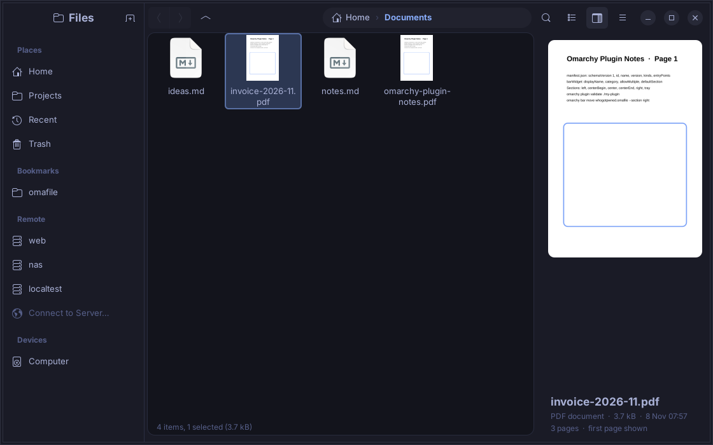
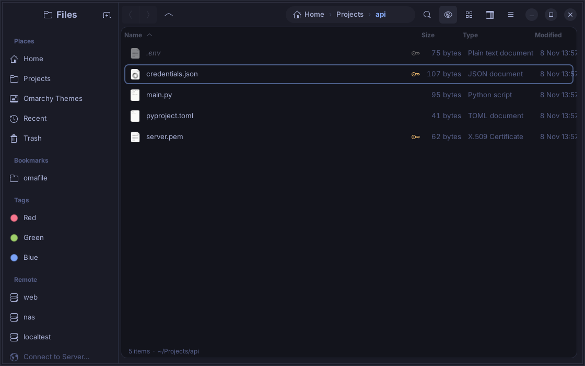
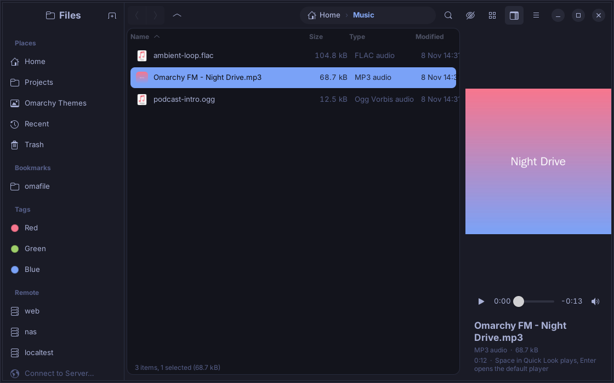
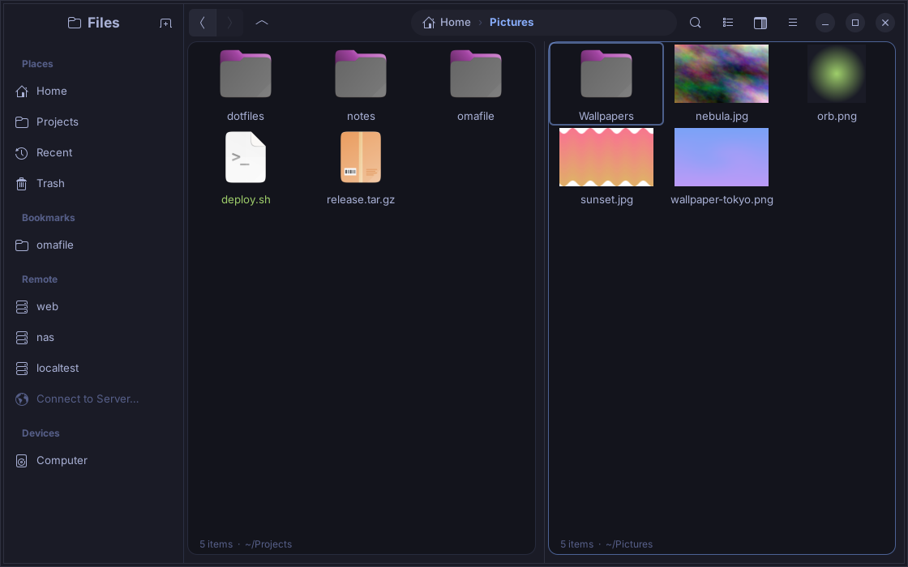
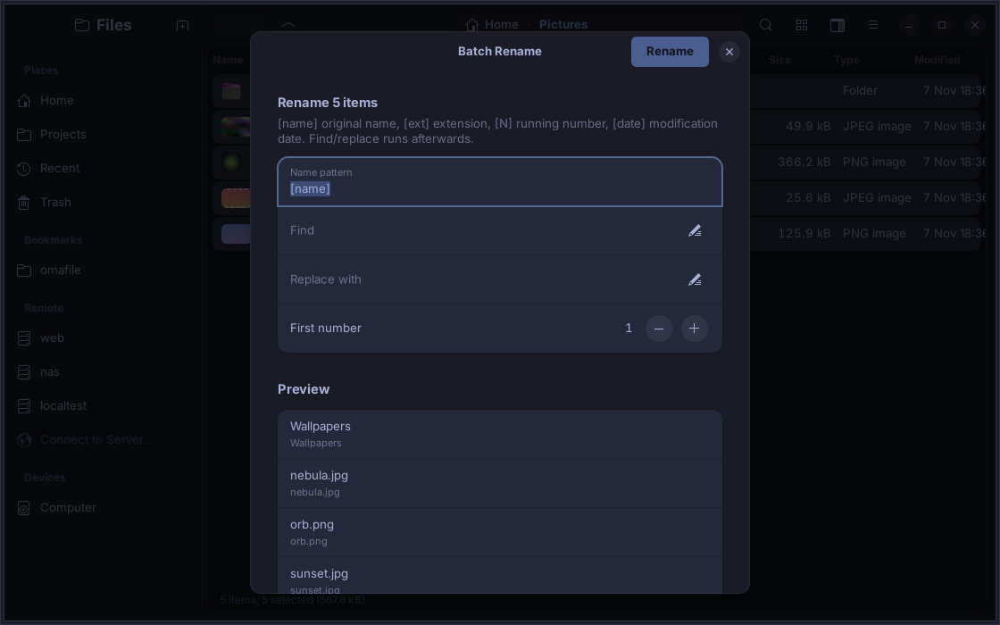

`omarchy` `omarchy-plugin` `hyprland` `wayland` `linux` `file-manager` `gtk4` `libadwaita` `rust` `sftp` `scp` `quickshell` `tags` `thumbnails` `pdf-preview` `git` `gocryptfs` `encryption` `command-palette` `vte` `terminal` `arch-linux`

<p align="center">
  
</p>

# omafile

[](#bar-button-omarchy-shell-plugin)
[](#how-it-follows-omarchy)
[](Cargo.toml)
[](PKGBUILD)
[](LICENSE)

A native GTK 4 / libadwaita file manager for [Omarchy](https://omarchy.org),
plus an Omarchy shell plugin that puts it on the bar. It looks like it shipped
with the system: colours, accent, light/dark mode and the icon theme come from
the active Omarchy theme and follow along live when you switch themes.



## Features

| | |
|---|---|
|  | **List and grid views** with sortable columns, rubber-band and multi-selection, live reload when a folder changes. |
|  | **Previews in the icon**, like Finder and Explorer: text and source files show a small page with their first lines, images and SVGs their picture, PDFs their first page, videos a frame (`ffmpegthumbnailer`, else `ffmpeg`), music its cover art, theme folders their `preview.png`. Everything decodes off the main thread and is cached; credential files are never rendered. |
|  | **Play button on the icon**, as in Finder: every song and video carries a round play badge over its thumbnail, centred in the grid and in the corner of the list icon. One click selects the file and starts it in Quick Look, no need to find the right app first. |
|  | **Hidden files**: the eye button in the header (or `Ctrl+H`) shows or hides dotfiles and backups. While hidden the status line says how many there are (`14 items (+2 hidden)`); while shown they stay clearly apart: dimmed, italic, with a greyed icon. |
|  | **Play music and video in place**: an audio file shows its cover and transport controls in the preview pane, `Space` (Quick Look) starts playing right away, *Play* in the context menu does the same; `←`/`→` move through the album. Videos play in the preview and in Quick Look with GTK's player. GStreamer does the decoding, so MP3, FLAC, Ogg and Opus work out of the box and H.264 / AAC need `gst-libav`. |
|  | **Tabs and the preview pane** (`F3`). Images, PDFs (first page, page count), text files in monospace, folder item counts. |
|  | **Split view** (`F6`): two sets of tabs side by side, each with its own history. Drag files across, or between a local and a remote tab. The active side carries the accent border. |
|  | **Editable path bar** (`Ctrl+L`): the breadcrumb turns into a text field with the cursor at the end, so you fix one segment instead of retyping (`Ctrl+A` selects it all to start over). Folders complete as you type: `Tab` accepts, `↑`/`↓` pick, `Enter` opens. `~`, relative paths, `sftp://` and `user@host` all work. |
|  | **Quick Look** (`Space`), as on macOS: a large preview of the selected file without opening it. PDFs show their first page and page count, images fill the window, text files show their content, folders their item count. `←`/`→` walk through the folder while it is open, `Space` or `Esc` closes. The preview pane (`F3`) is the persistent sidebar variant of the same thing; both can be toggled on and off at any time. |
|  | **Terminal panel** (`` Ctrl+` `` or `F7`): your login shell in a VTE terminal docked under the file list, the way VS Code does it. It opens in the folder you are looking at and follows along as you navigate (a `cd` with a leading space, kept out of history); with fish, zsh or a bash prompt that reports its folder (OSC 7) a `cd` in the terminal moves the file view too. Colours are the same mapping Omarchy applies to Alacritty, so it looks like your other terminals; the font is the system monospace font. Drag the splitter to resize, `Ctrl+Shift+C`/`V` copy and paste, `exit` restarts the shell. One terminal per tab, so split view gives you two. |
|  | **Git awareness**: inside a repository every row carries its status badge (`M` modified, `?` untracked, `A` added, `D` deleted, `!` conflict), folders inherit the strongest state of their contents, and the status line shows `repo on branch · 1 modified · 2 untracked` plus a branch button. `GIT_OPTIONAL_LOCKS=0`, refreshed with the folder. |
|  | **Git without a terminal**: click a badge to stage or unstage that file (a staged badge is outlined), *Git › Stage / Unstage / Discard Changes…* on a selection, *Commit…* (`Ctrl+Alt+C`) with summary, body and "stage all first", and the branch button or `Ctrl+Alt+B` to switch or create a branch. Errors arrive as one-line toasts (a missing identity tells you which `git config` to run). |
|  | **Diff preview**: a file with local changes shows its coloured `git diff` in the preview pane and in Quick Look instead of the plain text, with the index diff appended and the `+`/`−` count underneath. Untracked files diff against nothing, so you see what a new file would add. |
|  | **Conflicts and progress**: paste, drop, Copy To and Move To go through one queue. An existing target asks *Replace*, *Skip*, *Keep Both* (`name (1)`) or *Cancel*, with both sizes and dates and *apply to all*. A banner at the bottom shows what is being copied with a real progress bar; *Cancel* stops it and removes the half-written file. Folders are copied file by file so cancelling and progress work for them too. |
|  | **Trash with memory**: in the trash two extra columns show when an item was deleted and where it came from; `Ctrl+Shift+R` or *Restore* puts it back there. |
|  | **Rename in place** (`F2`): the name turns into a text field on the row, the stem is preselected, `Enter` renames, `Esc` cancels. `Shift+F2` opens the dialog instead, several selected files open batch rename. |
|  | **Folder sizes** (`Ctrl+Shift+U`): measures every folder in view in the background, fills the Size column and sorts by it, so the biggest directories come first, the way a disk usage tool would. *Properties* on a folder calculates its size too. |
|  | **Secrets protection**: files that usually hold credentials (`.env`, `id_rsa`, `*.pem`, `*.key`, `*.p12`, `*.kdbx`, `credentials.json`, `.netrc`, `.npmrc`, `.git-credentials`, `kubeconfig`, …) get a key badge, their preview and Quick Look are masked, and copying one asks first so a secret does not end up on the clipboard or in a chat by accident. `.env.example` and `*.pub` are exempt. |
|  | **Omarchy themes**: the sidebar has an *Omarchy Themes* place; theme folders show their `preview.png` as thumbnail (any folder with a `preview.png`, `cover.jpg` or a `backgrounds/` directory does), and *Apply Omarchy Theme* on one runs `omarchy-theme-set`. On an image, *Image › Set as Wallpaper* runs `omarchy-theme-bg-set`. |
|  | **Image tools** (context menu › Image, or the palette): rotate left/right in place, convert to PNG / JPEG / WebP, resize by width, height or percent. Conversions and resizes are written next to the original as new files and can be undone (they go to the trash) and redone. Needs ImageMagick. |
|  | **Share**: *Copy scp Command* puts `scp user@host:/path .` on the clipboard for the selection; *Share on Local Network…* serves it over HTTP from a scratch folder of links (only what you picked, never the siblings) and shows the link and a QR code (`qrencode`) until you close the dialog. |
|  | **Container volumes**: Docker and podman volumes whose mount point you can read appear under *Containers* in the sidebar. Rootless podman volumes always qualify; Docker's live under `/var/lib/docker`, which is root-only, so they show up only when that is readable (the screenshot uses a stub daemon). |
|  | **Sessions**: tabs, the split view, which terminal panels were open and the window size come back on the next start (`omafile` without a folder argument). Off in Preferences if you prefer a clean window. |
|  | **Command palette** (`Ctrl+K`), the Walker / VS Code pattern: fuzzy search over every action with its shortcut, places, bookmarks, recent folders, SSH hosts and the project commands of the current folder. Type `> cargo test` to run anything in a terminal here. `↑`/`↓` or `Tab` pick, `Enter` runs. |
|  | **Project actions**: omafile recognises what a folder is (`Cargo.toml`, `package.json`, `pyproject.toml`, `go.mod`, `PKGBUILD`, `compose.yml`, `Makefile`/`justfile`, an Omarchy plugin, a git checkout) and offers the matching commands in the context menu and the palette: `cargo test`, `npm run dev`, `makepkg -si`, `docker compose up`, `git log` … They run in Alacritty in that folder and wait for Enter, so output stays readable. *Open in Editor* (`Ctrl+E`, `Ctrl+Shift+E` for the folder) uses Omarchy's `omarchy-launch-editor`, so it lands in Neovim. Teams add their own commands with a `.omafile.toml` in the repository. |
|  | **Encrypted folders** with gocryptfs: *New Encrypted Folder…* asks for a name and password and creates `Name.gocryptfs` (the ciphertext) next to `Name` (where files appear while unlocked). Unlock, lock and change the password from the context menu; the password only ever travels through a pipe. The master key for emergencies is shown once. Because gocryptfs encrypts file by file, the `.gocryptfs` folder is the thing to back up, sync or move to another machine: copy it anywhere, unlock it there with the same password. |
|  | **Undo and redo** (`Ctrl+Z`, `Ctrl+Shift+Z`), borrowed from Nautilus and Finder: move, copy, paste, rename, batch rename, duplicate, new folder/file, trash and tag changes can all be taken back, every toast carries an Undo button, and trashed items are restored from the trash by their original path. |
|  | **Recursive search** (`Ctrl+Shift+F`) through the current folder and everything below. `fd` streams matches while it walks, results appear in batches as they arrive, the previous search is killed the moment you type on, and the final list is ranked (name starts with the query, name contains it, path contains it). On a 5,300-file tree a short query returns in about 40 ms, a query with 200+ hits in under 300 ms including the file information for every hit. A GIO walk takes over where `fd` cannot go, such as SFTP servers. |
|  | **Batch rename**: select several files and press `F2`. Pattern with `[name]`, `[ext]`, `[N]`, `[date]`, then find/replace, with a live preview and conflict detection. |
|  | **SFTP / SCP**: hosts from `~/.ssh/config` in the sidebar, *Connect to Server…* for `user@host[:port]/path`, native credential prompts, mounted servers under *Devices*. Copy, paste, drag and drop, rename and preview work on remote files like on local ones. |
|  | **Custom icons** per folder or file (`Ctrl+Alt+I`): pick one from the icon theme or use your own image. Stored as GIO metadata, so Nautilus shows the same icon. |
|  | **Preferences** (`Ctrl+,`): override the icon theme (by default omafile follows the Yaru variant Omarchy's theme asks for), thumbnails, default view, hidden files. |
|  | **Tags**, Finder style: give folders and files one of seven colours (`Ctrl+Alt+1…7`, `Ctrl+Alt+0` removes). The dot shows in list and grid, every colour in use appears under *Tags* in the sidebar and lists all tagged items wherever they are. Tags are stored as GIO metadata on the file and in an index, and follow renames and moves done in omafile. |
|  | **Theme following**: here the same build after `omarchy theme set "Catppuccin Latte"`, which turned the window light and the folders blue, without a restart. |

Also: *Copy To…* and *Move To…* with a folder picker and *Duplicate*
(`Ctrl+Shift+D`) from the context menu, bookmarks shared with the GTK file chooser (`Ctrl+D`), *Recent* and
*Trash* with restore and empty, drag and drop onto sidebar places, extract and
create archives via `bsdtar`, cut/copy/paste shared with other apps, properties,
open with…, copy path, open terminal here (`uwsm app -- alacritty`), context
menus and a shortcut for everything (`Ctrl+?`).

<details>
<summary>More screenshots</summary>

Context menu


Connect to Server


Custom folder icon applied


Lock, unlock and change the password of an encrypted folder from its context menu


A tag opened from the sidebar lists every tagged item with its location


</details>

## Install

### Requirements: what Omarchy brings, what you add

omafile is built for a stock Omarchy install and uses what is already there.
Only three things are not part of Omarchy: the Rust toolchain to build it,
the VTE library for the terminal panel, and gocryptfs for encrypted folders.

```sh
sudo pacman -S --needed rust vte4          # build + terminal panel (required)
sudo pacman -S --needed gocryptfs          # encrypted folders (optional)
```

Everything in detail. "Stock Omarchy" means the package is in Omarchy's own
package list or pulled in by one that is (Nautilus, Evince, pacman):

| Component | Used for | Stock Omarchy | If it is missing |
|---|---|---|---|
| `rust` (cargo) | building omafile, `makepkg` | no | `sudo pacman -S --needed rust`; only needed to build, not to run |
| `gtk4`, `libadwaita` | the whole UI | yes (Nautilus depends on them) | `sudo pacman -S --needed gtk4 libadwaita` |
| `vte4` | terminal panel (`` Ctrl+` ``) | **no** | `sudo pacman -S --needed vte4`; required, the binary links against it |
| `gvfs` (+ `gvfs-smb`, `gvfs-nfs`, `gvfs-mtp`) | trash, drives, SFTP and other servers | yes | `sudo pacman -S --needed gvfs` |
| `gocryptfs` (+ `fuse3`) | encrypted folders | **no** | `sudo pacman -S --needed gocryptfs`; without it the vault entries report what to install |
| `git` | status badges, branch line, git actions | yes | badges simply stay off |
| `fd` | fast recursive search | yes | omafile falls back to a slower GIO walk |
| `poppler` (`pdftoppm`, `pdfinfo`) | PDF thumbnails and previews | yes (Evince depends on it) | PDFs show the generic icon |
| `ffmpegthumbnailer`, `ffmpeg` | video thumbnails; audio cover art | yes | videos and songs show the generic icon |
| `gstreamer` + `gst-plugins-good` (`gst-plugins-bad`, `gst-libav` for H.264 / AAC) | playing audio and video in the preview | base and good: yes | the player shows which decoder is missing |
| `libarchive` (`bsdtar`) | extract / compress | yes (pacman depends on it) | the archive entries do nothing |
| `util-linux` (`script`) | capturing the master key when a vault is created | yes (base) | the vault is created without showing a master key |
| `imagemagick` (`magick`) | Image › rotate, convert, resize | yes | the Image menu reports that it is missing |
| `qrencode` | QR code in *Share on Local Network* | yes | the dialog shows the link only |
| `python` | *Share on Local Network* (`http.server`) | yes | sharing is unavailable |
| `docker` or `podman` | container volumes in the sidebar | docker: yes | the *Containers* section stays hidden |
| `jq` | `plugin/validate.sh`, `omarchy plugin` commands | yes | only needed for plugin development |
| `xdg-desktop-portal-hyprland`, `xdg-desktop-portal-gtk` | Open With…, file dialogs | yes | GTK falls back to its own dialogs |
| a terminal: `$TERMINAL`, else `xdg-terminal-exec` (Omarchy's default, foot), else foot, alacritty, kitty, ghostty | Open Terminal Window Here, project commands | yes | set `TERMINAL` |
| `omarchy-launch-editor` | Open in Editor | yes | `$VISUAL`/`$EDITOR` in a terminal |
| `uwsm` | launching windows as session apps | yes | commands run directly |
| Yaru icon themes | file icons matching the theme | yes | the Adwaita icons are used |
| hicolor icon theme | omafile's own app icon (dock, launcher, About) | yes | `install.sh` and the PKGBUILD put the SVG into `hicolor/scalable/apps` |
| Omarchy shell (`omarchy-shell`, Omarchy 4 and later) | the bar button plugin | yes on current Omarchy | older Waybar-based releases cannot load shell plugins; the file manager itself still works there |

`install.sh` checks the build requirements before compiling and lists any
optional tool it cannot find.

### Build and install

```sh
git clone https://github.com/whogotpwned/omafile
cd omafile
./install.sh --all
```

That builds a release binary into `~/.local/bin`, installs the desktop entry
(launcher and "Open With" target), makes omafile the default application for
folders, and rebinds the file manager shortcut: on current Omarchy (Lua
configuration) it appends to `~/.config/hypr/bindings.lua`

```lua
o.rebind("SUPER + SHIFT + F", "File manager", { launch = "omafile" })
o.rebind("SUPER + ALT + SHIFT + F", "File manager (cwd)", "setsid uwsm-app -- omafile \"$(omarchy-cmd-terminal-cwd)\"")
```

and on older releases it edits `~/.config/hypr/bindings.conf`. Pass `--default`
or `--bind` for only one of the two, or nothing for just the binary.

Arch package: `makepkg -si` (the PKGBUILD declares the same dependencies, so
pacman installs `vte4` for you), remove with `sudo pacman -Rns omafile`.

### Uninstall

```sh
./uninstall.sh            # binary, desktop entry, shortcuts, default-app setting
./uninstall.sh --purge    # also ~/.config/omafile (preferences, tags)
omarchy plugin remove whogotpwned.omafile   # the bar button, if you added it
```

`uninstall.sh` reverses `install.sh` step by step: it hands folders back to
Nautilus if omafile was the default, removes only the binding lines
`install.sh` appended, and leaves everything else in your config untouched.

### Bar button (Omarchy shell plugin)

The repository doubles as an Omarchy shell plugin: `manifest.json` at the root
and the widget in `plugin/BarWidget.qml`.

```sh
omarchy plugin add https://github.com/whogotpwned/omafile.git --enable
```

The widget lands in the `left` section next to the Omarchy menu. Put it where
you like, the same way as every other widget:

```sh
omarchy bar move whogotpwned.omafile --section right        # left | centerBegin | center | centerEnd | right | tray
omarchy bar move whogotpwned.omafile --section centerEnd --index 0
omarchy bar set  whogotpwned.omafile path ~/Projects        # folder opened on click
```

Drag and drop in the bar and *Appearance › Menu Bar* in the Omarchy menu work
too. `omarchy plugin add` asks for the section interactively as well.

What the button does:

| Click | Action |
|---|---|
| Left | Raises the omafile window that is already open (`omarchy-launch-or-focus`), otherwise opens the configured folder |
| Right | Places menu: Home, Downloads, Documents, Pictures, Projects, Trash, the folder of the active terminal, new window, and *Lock all encrypted folders* while any is unlocked |
| Middle | Opens the folder of the active terminal (like Omarchy's own "File manager (cwd)" binding) |

The button also shows a small marker: `⇅` while a copy or move is running and a lock glyph while encrypted folders are unlocked. omafile writes `~/.local/state/omafile/status` (`busy=0|1`, `vaults=N`) and the widget watches that file with Quickshell's `FileView`.

The icon is a Nerd Font folder glyph drawn with the bar's font, exactly like
the first-party widgets, so it matches the bar in every theme. `omarchy bar
set whogotpwned.omafile icon "󰉋"` swaps it for any other glyph. The popup uses
the shell's own `PopupCard` and `PopupMenuRow` components and therefore takes
the theme's popup colours and corner radius.

Removal is `omarchy plugin remove whogotpwned.omafile`, which disables the
widget, drops it from the bar layout and deletes the checkout.

## Keyboard shortcuts

| Keys | Action |
|---|---|
| `Alt+←` `Alt+→` `Alt+↑` `Backspace` | Back, forward, parent |
| `Ctrl+L` | Edit the path in place; `Tab` completes folders (`~`, `/path`, `sftp://host/`, `user@host`) |
| `Ctrl+F` / `Ctrl+Shift+F` | Filter this folder / search subfolders |
| `Ctrl+T` `Ctrl+W` `Ctrl+Tab` | New, close, next tab |
| `Ctrl+Enter` / middle click | Open folder in new tab |
| `F3` `F6` `F9` | Toggle preview pane, split view, sidebar |
| `Ctrl+1` `Ctrl+2` `Ctrl+H` | List, grid, hidden files (also the eye button in the header) |
| `Space` on a song | Quick Look plays it; context menu › Play |
| `Enter` `Ctrl+Shift+O` `F4` | Open, open with…, terminal here |
| `Space` | Quick Look (toggle); `←` `→` walk the folder inside it |
| `Ctrl+Shift+N` `Ctrl+Alt+N` | New folder, new file |
| `F2` / `Shift+F2` | Rename in place / in a dialog; batch rename with several files selected |
| `Ctrl+Shift+U` | Folder sizes, sorted by disk usage |
| `Ctrl+Shift+R` | Restore from trash |
| `Ctrl+Alt+C` / `Ctrl+Alt+B` | Git commit / switch branch (click a badge to stage or unstage) |
| `Ctrl+Alt+I` | Change icon |
| `Ctrl+Alt+1…7` / `Ctrl+Alt+0` | Tag red, orange, yellow, green, blue, purple, gray / remove tag |
| `Ctrl+C` `Ctrl+X` `Ctrl+V` `Ctrl+Shift+C` | Copy, cut, paste, copy path |
| `Ctrl+Z` `Ctrl+Shift+Z` | Undo, redo |
| `Ctrl+K` | Command palette |
| `` Ctrl+` `` `F7` | Terminal panel below the files |
| `Ctrl+E` `Ctrl+Shift+E` | Open selection / folder in the editor |
| `Ctrl+Shift+D` | Duplicate |
| `Delete` `Shift+Delete` | Trash, delete permanently |
| `Ctrl+D` `Ctrl+Shift+K` `Ctrl+I` | Bookmark, connect to server, properties |
| `Ctrl+,` `Ctrl+?` `Ctrl+Q` | Preferences, shortcuts, quit |

Every shortcut is exercised by an automated run (`OMAFILE_TRACE=1` logs each
action; a script presses every accelerator under Xvfb and checks that the
matching action fired). Shortcuts that also mean something in a text field
(`Ctrl+A/C/X/V`, `Backspace`, `Delete`) act on the text while a field has
focus and on files otherwise.

## Command line and launchers

```
omafile [FOLDER…]        open folders (one window each); without arguments the last session is restored
omafile --print-recent   recent folders, newest first, one path per line
omafile --lock-all       unmount every unlocked gocryptfs folder (what the bar button's "Lock all" runs)
omafile --version
```

Recent folders are kept in `~/.local/state/omafile/recent`, so a launcher can offer them. A Walker / dmenu style picker:

```bash
#!/bin/bash
# omafile-recent: pick a recent folder and open it
dir=$(omafile --print-recent | sed "s|^$HOME|~|" | walker --dmenu -p "Recent folders") || exit 0
exec uwsm-app -- omafile "${dir/#\~/$HOME}"
```

Bind it next to the file manager binding in `~/.config/hypr/bindings.lua`:

```lua
o.rebind("SUPER + SHIFT + R", "Recent folders", { launch = "omafile-recent" })
```

## Motion

Panels move the way the rest of Omarchy moves instead of snapping: the terminal panel slides up from the bottom edge and back down (`` Ctrl+` ``), the split view slides its divider in from the right (`F6`), a new folder fades in like a Hyprland window, thumbnails cross-fade over their icon as they arrive, and hover and selection colours ease. All of it uses libadwaita's animations with an ease-out-quint curve over about 260 ms, so turning off `gtk-enable-animations` (or the system's reduce-motion setting) switches every effect off at once.

## How it follows Omarchy

- **Palette.** omafile reads `~/.local/state/omarchy/current/theme/colors.toml`
  (the semantic keys `background`, `foreground`, `accent`, `selection`,
  `muted`, `dark_background`, `lighter_background`, …) and maps them onto
  libadwaita's named colours plus its own widget styles. Older installs with
  `~/.config/omarchy/current/theme/alacritty.toml` are read as well.
- **Mode.** `mode = "light"` in `colors.toml` (or the legacy `light.mode`
  marker, or background luminance for custom themes) picks light or dark.
- **Icons.** The theme's `icons.theme` names the icon set (Omarchy ships Yaru
  variants); omafile applies it so the folders match even before GNOME
  settings catch up. Preferences can override it with any installed theme.
- **Live.** A `GFileMonitor` on the `current` directory catches the symlink
  swap `omarchy-theme-set` performs and re-skins open windows.
- **Launching.** Windows are opened through `uwsm-app`, the terminal through
  `uwsm app -- $TERMINAL`, files through the desktop portal.
- **Shell plugin.** The bar widget follows the first-party `omarchy.menu`
  widget: a `BarIconButton` inside a `BarWidget`, colours and font from the
  bar, commands run through `bar.run`. The manifest keeps the
  `whogotpwned.*` namespace (`omarchy.*` is reserved), declares
  `schemaVersion: 1`, the `bar-widget` kind with its `entryPoints.barWidget`,
  and a `defaultSection`. `omarchy plugin validate .` passes.

### Publishing as an Omarchy plugin

Omarchy plugins are distributed as git repositories; there is no package to
build. Anyone installs, updates and removes the bar button with the normal
plugin commands, interactively or with `--yes` for scripts:

```sh
omarchy plugin add https://github.com/whogotpwned/omafile.git --enable   # asks for the bar section
omarchy plugin list
omarchy plugin update whogotpwned.omafile
omarchy plugin disable whogotpwned.omafile
omarchy plugin enable whogotpwned.omafile --section right
omarchy plugin remove whogotpwned.omafile
```

`add` clones this repository into `~/.config/omarchy/plugins/whogotpwned.omafile`,
runs the same validation as the shell, refuses duplicate ids, never executes
anything from the repository and never asks for sudo. `remove` disables the
widget, drops it from the bar layout and deletes the checkout. The file
manager binary is separate (`install.sh`, PKGBUILD or a future AUR package),
so removing the plugin never touches it and vice versa.

Release checklist for the maintainer:

1. Bump `version` in `Cargo.toml`, `PKGBUILD` and `manifest.json` together.
2. Run `cargo test`, `cargo clippy` and `omarchy plugin validate .` (the same
   checks are mirrored in `plugin/validate.sh` for machines without Omarchy).
3. Commit, tag `vX.Y.Z`, push. `omarchy plugin update` fast-forwards users to
   the new commit on the default branch, so keep that branch releasable.
4. Submit the repository URL at [plugins.omarchy.org](https://plugins.omarchy.org),
   the marketplace the Omarchy manual points to. Suggested GitHub topics so it
   is found: `omarchy`, `omarchy-plugin`, `file-manager`, `hyprland`, `gtk4`.

What the shell enforces at load time and what this repository does:

| Rule | Here |
|---|---|
| Git repo with `manifest.json` at the root | yes |
| `schemaVersion` exactly `1`; `id`, `name`, `version`, `kinds`, `entryPoints` present | yes |
| `id` is `[A-Za-z0-9][A-Za-z0-9._-]*`, not in the reserved `omarchy.*` namespace, never changes | `whogotpwned.omafile` |
| Every kind has its entry point (`bar-widget` → `entryPoints.barWidget`), relative path, no `..`, file exists | `plugin/BarWidget.qml` |
| `barWidget.defaultSection` ∈ left, centerBegin, center, centerEnd, tray, right | `left` |
| No symlinks anywhere in the folder | none |
| Theme colours only via `qs.Commons`, UI via `qs.Ui` components | `BarIconButton`, `PopupCard`, `PopupMenuRow` |
| Plugins run unsandboxed inside `omarchy-shell`, no install hooks, no sudo | the widget only runs `omafile` and `omarchy-launch-or-focus` on click |

## Encrypted folders in detail

- **Format.** gocryptfs: AES-256-GCM per file, file names encrypted (EME),
  keys derived from the password with scrypt. The `.gocryptfs` directory
  holds only ciphertext plus `gocryptfs.conf` (the wrapped master key).
- **Migration and backup.** Copy or sync `Name.gocryptfs` with any tool
  (rsync, a USB stick, a cloud folder, `scp`). On the other machine, put it
  next to an empty `Name` folder and use *Unlock Encrypted Folder…*, or
  `gocryptfs Name.gocryptfs Name` on the command line. Changing the password
  rewraps the master key inside `gocryptfs.conf`, so a copy made before the
  change still opens with the old password; copy again afterwards. The master
  key shown once at creation opens the folder without any password, keep it
  in a password manager as the last resort.
- **Handling.** Unlocking mounts the folder for your user only (FUSE, no
  root). Lock it with the context menu, or it stays unlocked until logout.
  The password is piped to gocryptfs and never written to disk or passed on
  a command line. Deleting the ciphertext folder deletes the data.
- **Scope.** Local file systems only; a vault cannot live on an SFTP share.

## Project actions file

`.omafile.toml` in a project root adds commands to the *Project* submenu and
the command palette for everyone who opens the folder with omafile:

```toml
[[action]]
name = "Deploy to staging"
command = "./deploy.sh staging"

[[action]]
name = "Run migrations"
command = "docker compose exec app rails db:migrate"
```

Commands run through `bash -lc` in the project folder inside a terminal
window and wait for Enter before closing.

## Preferences file

`~/.config/omafile/omafile.conf`, written by the Preferences dialog:

```
icon-theme = Yaru-purple
thumbnails = true
view = grid
show-hidden = false
```

Tags live next to it in `~/.config/omafile/tags` (`uri<TAB>colour` per line).
Delete the directory to go back to following the theme for everything.

## Development

```sh
cargo run -- ~/Projects
cargo test
cargo clippy
```

| Module | Role |
|---|---|
| `theme` | colors.toml / alacritty.toml parsing, CSS, icon theme, live reload |
| `item` | `FileItem` GObject (file + info, custom icons) for the list models |
| `ops` | async GIO operations: list, copy, move, trash, delete, rename, archives |
| `pane` | one tab: views, filter, recursive search, selection, drag and drop |
| `window` | shell: sidebar, header, path bar, tabs, split view, preview, mounting |
| `preview` | preview pane |
| `thumbs` | thumbnail cache; images via gdk-pixbuf, PDFs via pdftoppm |
| `search` | recursive search with fd or a GIO walk |
| `remote` | ssh config hosts, server URIs, GTK bookmarks |
| `extras` | preferences, icon chooser, batch rename |
| `tags` | colour tags: metadata, index file, virtual listings |
| `git` | repository status for badges and the status line |
| `projects` | project detection, actions, `.omafile.toml`, editor and terminal launch |
| `palette` | command palette with fuzzy matching |
| `crypt` / `vaultui` | gocryptfs vaults and their dialogs |
| `termpanel` | embedded VTE terminal that follows the folder |
| `undo` | undo/redo journal |
| `transfer` | copy/move queue: conflict dialog, progress banner, cancel |
| `gitui` | stage, unstage, discard, commit and branch dialogs |
| `imagetools` | ImageMagick rotate / convert / resize, wallpaper and theme hooks |
| `share` | scp command, local network share with QR code |
| `containers` | docker / podman volume discovery |
| `omarchy` | theme folders, `omarchy-theme-set`, `omarchy-theme-bg-set` |
| `session` / `status` | session file; status file for the bar widget, recent list, `--lock-all` |
| `motion` | slide and fade animations (libadwaita TimedAnimation, respects reduced motion) |
| `completion` / `quicklook` | path completion, Quick Look |
| `prefs` | the preferences file |
| `actions` | window actions, clipboard, dialogs, properties, shortcuts |
| `plugin/` | the Omarchy shell bar widget |

## License

MIT
