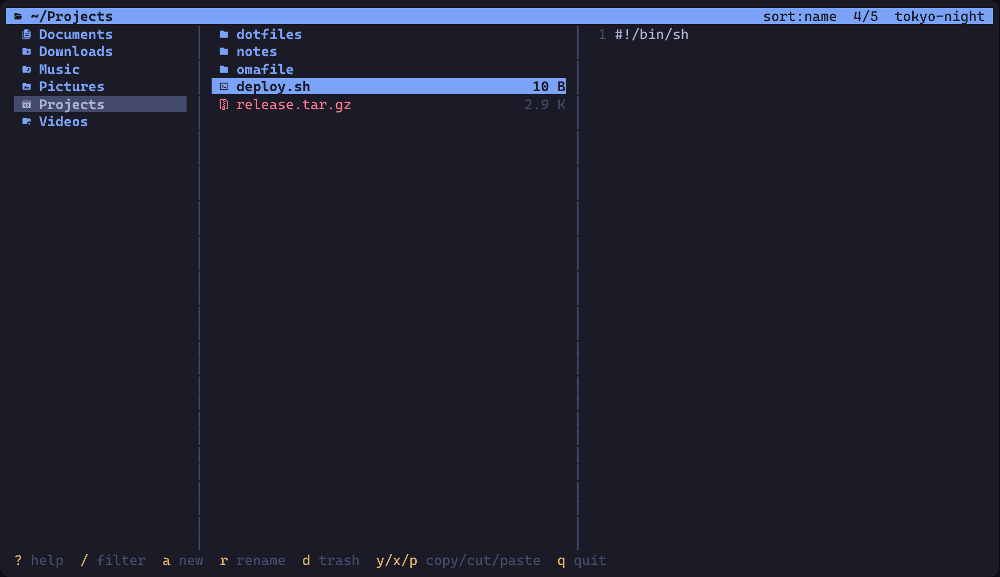
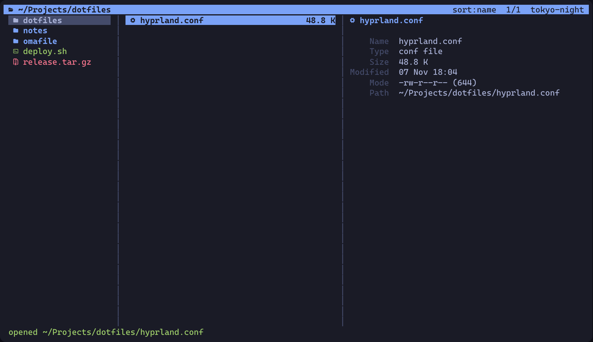

# omafile

A keyboard-driven file manager built for [Omarchy](https://omarchy.org).
It runs in Alacritty, speaks vim, and picks up whatever theme is active in
`~/.config/omarchy/current/theme`: switch themes with `omarchy-theme-set` and
omafile recolours itself live without a restart.



```
   ~/Projects                                              sort:name  3/12  tokyo-night
  7 Documents       │   omafile                           │  1 # omafile
  d Downloads       │   dotfiles                          │  2
  b Projects        │   notes                             │  3 A keyboard-driven file manager
  f Pictures        │   README.md                  2.1 K  │  4 built for Omarchy...
                    │   todo.txt                    311 B │  5
 ? help  / filter  a new  r rename  d trash  y/x/p copy/cut/paste  q quit
```

<details><summary>More screenshots</summary>




</details>

## Why

Omarchy is terminal-first and keyboard-first. Nautilus is neither. omafile is
a small single binary that feels like the rest of the setup:

- **Theme-native**: reads the 16-colour palette from the active Omarchy theme
  (`alacritty.toml`) and reloads when the theme changes.
- **Nerd Font icons** via CaskaydiaMono, which Omarchy ships.
- **Vim keys**, Miller columns (parent / current / preview), live filter.
- **Wayland-aware**: copies paths with `wl-copy`, opens files with `xdg-open`,
  spawns new terminals through `uwsm`.
- **Shell `cd` on exit**, like `yazi`/`ranger`, via the `of` wrapper.
- No config file. No plugins. One Rust binary, three crates.

## Install

```sh
git clone https://github.com/whogotpwned/omafile
cd omafile
./install.sh --bind     # builds, installs to ~/.local/bin, adds SUPER+SHIFT+F
```

`--bind` appends a Hyprland binding to `~/.config/hypr/bindings.conf`.
Without it, only the binary, desktop entry (shows up in Walker) and shell
helper are installed.

Arch package instead:

```sh
makepkg -si
```

Requirements: `rust` to build. Optional at runtime: `glib2` (trash),
`wl-clipboard` (`Y`), `xdg-utils` (`o`), `ttf-cascadia-mono-nerd` (icons).
All of these are already present on a stock Omarchy install.

### Replace Nautilus on SUPER+F

Add to `~/.config/hypr/bindings.conf`:

```
unbind = SUPER, F
bindd = SUPER, F, File manager (omafile), exec, uwsm app -- alacritty --class Omafile -e omafile
```

See `contrib/hyprland-bindings.conf` for a floating-window variant.

### Shell integration

```sh
# ~/.bashrc or ~/.zshrc
source ~/.local/share/omafile/shell-integration.sh
```

Then `of` (or `of ~/Downloads`) opens omafile and `cd`s your shell into the
directory you were in when you quit. Fish users get `of` automatically if
`~/.config/fish` exists.

## Keys

| Key | Action |
|---|---|
| `j` `k` `↓` `↑` | move |
| `h` `l` `←` `→` `Enter` `Backspace` | parent / open |
| `gg` `G` `Ctrl-d` `Ctrl-u` `PgUp` `PgDn` | jump |
| `-` `~` | previous directory / home |
| `Enter` | open: directories enter, text files edit, everything else `xdg-open` |
| `e` `o` | force `$EDITOR` / force `xdg-open` |
| `S` `t` | shell here / new terminal window here |
| `/` | filter as you type, `Enter` keeps it, `Esc` clears |
| `.` `s` `R` | toggle hidden / cycle sort / reload |
| `Space` `Ctrl-a` | mark / mark all |
| `y` `x` `p` | yank / cut / paste (marked entries or cursor) |
| `Y` | copy full path to the Wayland clipboard |
| `a` `A` `r` | new file / new directory / rename |
| `d` `D` | trash (`gio trash`) / delete permanently |
| `?` | help |
| `q` | quit |

## CLI

```
omafile [--cwd-file FILE] [--no-icons] [PATH]
```

`PATH` may be a file; omafile opens its directory with the file selected.

| Variable | Meaning |
|---|---|
| `EDITOR` / `VISUAL` | editor for text files, default `nvim` |
| `TERMINAL` | terminal spawned by `t`, default `alacritty` |
| `OMAFILE_THEME_DIR` | override the theme directory |
| `OMAFILE_ICONS=0` | ASCII instead of Nerd Font glyphs |

## Theme format

omafile only needs `<theme>/alacritty.toml` with the standard
`[colors.primary]`, `[colors.normal]` and `[colors.bright]` tables. Every
Omarchy theme ships one, so custom themes work unchanged. Missing keys fall
back to Tokyo Night.

## Development

```sh
cargo run -- ~/Projects
cargo test
cargo clippy
```

Modules: `theme` (palette parsing + live reload), `fs` (listing and file
operations), `preview` (text/dir/info pane), `app` (state + keys), `ui`
(ratatui rendering), `icons`.

## License

MIT
